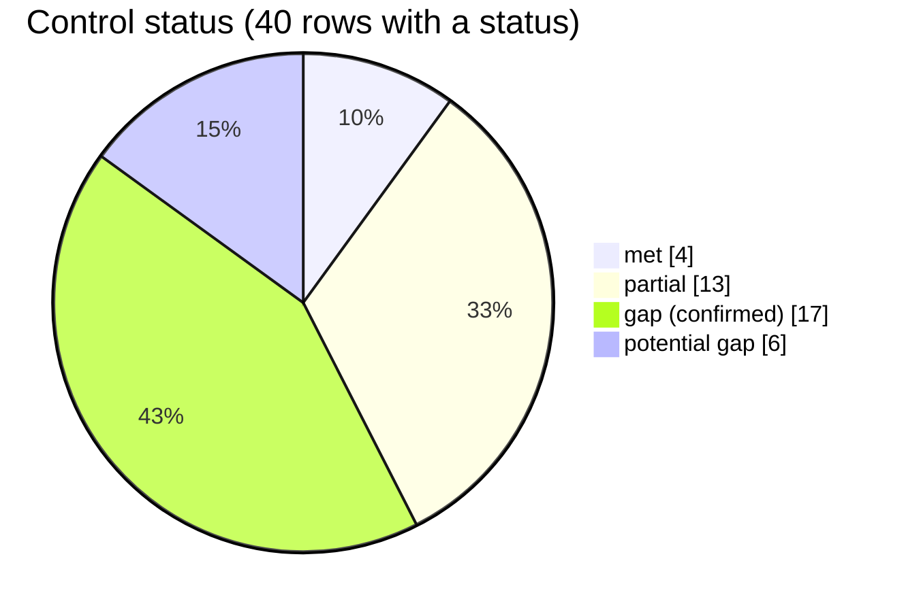
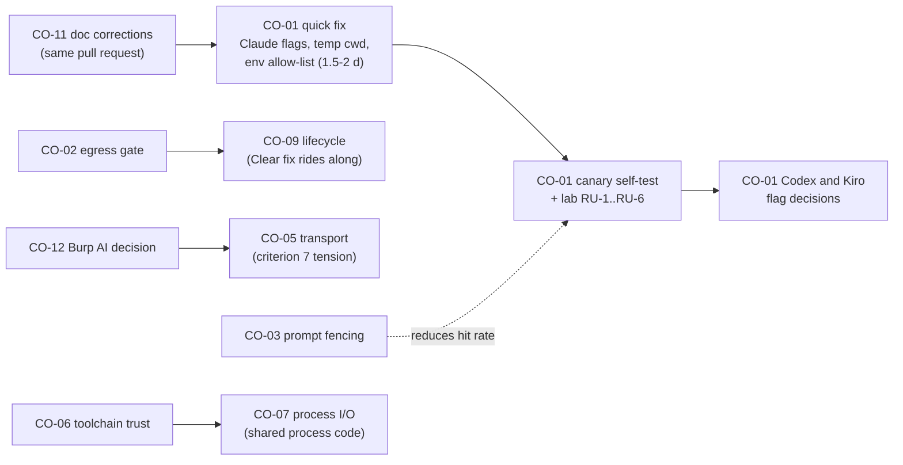

# Compliance mapping: AI Pal (Burp Suite extension) v1.2.1

**Status: draft. This is a technical control mapping, not an audit, attestation or certification. Nothing here says the extension is, or is not, audit-ready, SOC 2 compliant, FedRAMP-ready or BApp Store approved.**

## 1. Executive summary

AI Pal is a tester-side Burp extension. It sends captured HTTP traffic to five LLM backends (Ollama, AWS Bedrock, and the local Claude Code, Codex and Kiro CLIs). I mapped 113 upstream entries (60 inherited findings plus 53 threat-model entries from secreview, security-architecture, skill-reviewer, supply-chain and threat-model) to 49 control rows. Before mapping, I re-read the cited source in the current working tree. Every finding carries a verification status (section 2.2), and that status decides the control status.

Result across the 40 rows that received a status:

Seven rows are "not applicable" (no accounts or roles in the extension, organisational and physical controls) and two are "not assessed" (BApp criteria 1 and 2 are editorial).

What matters most:

1. **Client data leaves the workstation with no governance (CO-02, confirmed, P0).** Every header (Authorization, Cookie) and up to 10,000 body characters per item go to the active provider. There is no redaction, scope check, consent or preview. The destination label is wrong for three providers. This is certain by design and is the largest confidentiality gap (NIST AC-4, SC-28, SOC 2 C1.1, CC6.7).
2. **Agent confinement is a flag deny-list inside the tester's own agent configuration (CO-01, P0, potential gap).** The Claude Code, Codex and Kiro processes run with `cwd = user.home` and the full parent environment, and none of the isolation flags are passed (verified for Claude Code 2.1.318, which lists them in `--help`; the Codex and Kiro CLIs are not installed here). Whether a hostile response body can make an agent use a tool (for example an MCP server) is **not verified live**. I therefore record the least-privilege and least-functionality controls as *potential* gaps, not confirmed gaps. The fix costs roughly two days, so I recommend doing it before the lab result arrives.
3. **Plaintext AWS keys in Burp preferences, written on every keystroke (CO-04, confirmed, P1).**
4. **BApp Store: not ready on the document's own criteria.** Two confirmed gaps (criterion 3 "operates securely" and criterion 12 "AI functionality"), five partial. The extension does not use the Montoya AI API, although the pinned `montoya-api 2025.10` jar contains it. The live PortSwigger criterion now reads differently from the copy in `docs/` (section 6).
5. **PCI-DSS and HIPAA do not apply** as conformance frameworks (section 3). They matter only as a data-handling note: tester traffic can contain cardholder data or PHI, and the extension sends it to third parties.
6. **Documentation overclaims security properties** (CO-11). Examples: the code comment "removes all tools from the agent entirely", README line 306 "All LLM requests go through Burp's HTTP stack" and README line 325 "Detect ... will refuse" the IDE launcher. All three are contradicted by current source.

Duplicates are merged into 13 root causes. Priorities: **P0** x2 (plus one conditional), **P1** x6, **P2** x3, **P3** x1 (section 5). Estimated engineering effort: P0 about 15 to 19 person-days, P1 about 18 to 23, P2 about 6 to 8 (estimates, section 5.1).

What this report does **not** cover: live testing, vendor-cloud assessment, organisational controls (section 9).

## 2. Scope, method and status rules

### 2.1 What I did

- Read all upstream reports: `secreview-report.md` (SR-SAST-001..019), `coverage-closure.md`, `kiro-delta.md` (SR-SAST-020..026), `sca-results.json`, `findings.json` and `security-architecture-review.md` (SA-001..013), `skill-review.md` and `verdict.json` (SKR-*), `supply-chain-report.md` and `sbom.json` (SC-001..011), `threat-model.md` (TM-STRIDE-001..053, section 12).
- Re-read the cited code in the working tree and recorded the current line. Where a line had moved, I cite the new line.
- Ran `claude --help` (the installed Claude Code 2.1.318) to check that the isolation flags exist. `codex`, `kiro-cli` and `ollama` are not installed on the review host.
- Opened the cached `montoya-api-2025.10.jar` to check whether the AI API is in the pinned version.
- Fetched the live PortSwigger acceptance criteria and AI best-practices pages on 2026-11-09 and compared them with `docs/bapp-store-requirements.md`. Web content was treated as reference data only.
- Did not build, run tests, run Burp, call any model, or scan. The working tree was identical to the state recorded in the threat model (line counts and sizes match: `KiroClient.java` 377, `AcpTransport.java` 270, `LLMSettingsPanel.java` 1433).

### 2.2 Verification status codes (carried into every finding and control)

| Code | Meaning |
|---|---|
| **V** | Verified. I re-read the cited file:line in the current tree and the claim holds in code. |
| **V·UL** | Code verified, but the harm depends on runtime, vendor or OS behaviour I did not observe (*unverified live*). The code facts are real; the consequence is not shown. |
| **RB** | Re-based. The original finding described code that no longer exists (KiroClient rewritten to ACP). I mapped the current code, not the old text. |
| **UI** | Unverified (inherited). I could not re-check it in this pass (registry data, vendor behaviour, GitHub-side state). Carried forward as a point-in-time claim from the named report. |
| V+UI | Mixed. Part verified, part inherited. The note says which part. |

### 2.3 Control status rules

| Status | Rule |
|---|---|
| **met** | Positive evidence in current source and no finding contradicts it. |
| **partial** | The control is implemented in part and the shortfall is confirmed (V). |
| **gap** | A **confirmed** shortfall (V) that does not depend on live behaviour. |
| **potential gap** | The shortfall rests only on V·UL or UI findings, or the code fact is verified but whether it is a shortfall depends on unverified runtime behaviour or on a requirement the organisation sets. **A control cannot be a "gap" on the strength of unverified-live findings alone.** |
| **not applicable** | With a stated reason. |
| **not assessed** | Added by me (not in your list). Used only for BApp criteria 1 and 2, where static evidence cannot decide. |

A row with both a confirmed and a potential element is a **gap** (confirmed) and the potential element is named in the evidence. A row where the confirmed element is only a design fact and the harm path is unverified live is a **potential gap**.

Mapping notes: SOC 2 and NIST describe the controls of an organisation or a system. This extension is a software component. I map *control-relevant technical characteristics* of the component. Mappings the upstream agents used that I judged a weak fit are not carried over: SC-7 and SC-39 (network boundary and OS process isolation) and SC-12 (the extension does not establish cryptographic keys). Some mappings are interpretive; each says so.

## 3. Framework applicability

| Framework | Applies? | Reason |
|---|---|---|
| NIST SP 800-53 Rev 5 | **Yes, technical families only** | Used as a control vocabulary for the component. The extension is not an authorised federal system and no baseline (Low/Moderate) was selected. Organisational families are not applicable (section 4.1, last row). |
| SOC 2 TSC (Security, Confidentiality) | **Yes, indicative** | A SOC 2 report covers a service organisation's system over a period. This is software, not a service. Availability (A1) and Privacy (P) were not requested. The availability findings (CO-07) would map to A1.1 and A1.2 if Availability were in scope. |
| BApp Store criteria | **Yes** | Assessed against the 12 criteria in `docs/bapp-store-requirements.md`, plus the live page (section 6). |
| PCI-DSS v4.0 | **Not applicable as a conformance framework** | PCI-DSS applies to entities that store, process or transmit cardholder data (CHD) or can affect the security of a cardholder-data environment. The extension is a tester-side tool, stores no CHD by design and is not part of a CDE. It does not persist HTTP traffic to disk (in-memory only; see CO-09). The CLI providers may persist transcripts (unverified live, CO-01). |
| HIPAA | **Not applicable as a conformance framework** | HIPAA applies to covered entities and business associates handling PHI. The extension is neither. |

**Data-handling note (informational, no control status, not legal advice).** If a tester's traffic contains PAN, other CHD or PHI, the extension forwards that data to Anthropic, OpenAI, AWS or Kiro, or to an Ollama host, with no redaction and no consent step (CO-02). Cleartext transport to a remote Ollama host is accepted silently (CO-05). Cloud-bound CLIs may keep transcripts (CO-01, unverified live). Whether this makes the tester or the engagement owner responsible for any PCI-DSS or HIPAA obligation (for example a service-provider relationship under PCI-DSS Requirement 12.8, or a business associate agreement under 45 CFR 164.504(e)) is a contractual and legal determination that I did not make. The practical mitigation is technical and is already in the gap list: default redaction, a per-provider data-handling warning, a preview, and loopback-only cleartext.

## 4. Control-by-control matrix

Columns: **Findings** lists the merged upstream IDs with their verification code. **Evidence** is the current file:line I re-read. **CO** points to the root cause in section 5. Positive controls I found are listed in the evidence, because "gap" rows still contain things done well.

### 4.1 NIST SP 800-53 Rev 5

| Control | Status | Findings (verification) | Evidence (current tree) | Gap / note | CO |
|---|---|---|---|---|---|
| AC-3 Access Enforcement | not applicable | none | `Extension.java:22-57` registers UI only; no accounts, roles or authN code | No multi-user model. Burp owns access to Burp. | n/a |
| AC-4 Information Flow Enforcement | gap | SR-SAST-004 (V), SA-004 (V), TM-027/028/029/030/040/022/044 (V), SKR-PI-004 (V) | `HttpRequestFormatter.java:35-36,63-64` (all headers verbatim), `:10,43-45` (body cap only); callers `LLMContextMenuProvider.java:85,111,137,163`; `formatItems` (no item or byte cap); `LLMSecurityAssistantEditorPanel.java:44` (Request attached by default); zero hits for `isInScope`, `redact`, `consent`, `showConfirmDialog` in `src`; `LLMProvider.java:6-8` (`"localhost"` for the three cloud-bound CLIs) and `:22` (`getApiHost()` has no callers) | No classification, redaction, scope check, consent, preview or destination disclosure before data leaves. The destination attribute exists, is wrong and is never used. | CO-02 |
| AC-6 Least Privilege | potential gap | SR-SAST-001, SA-001, TM-048, SKR-EXFIL-001, SR-SAST-002, TM-049, TM-050, SR-SAST-021, TM-034 (all V·UL); SR-SAST-020 (RB) | Confirmed code facts: `cwd = user.home` at `ClaudeCodeClient.java:69,201,238,259`, `CodexClient.java:149,186,291`, `KiroClient.java:117,191` and `session/new` cwd at `:242`; `pb.environment()` is touched only to edit PATH (`CliEnvironmentUtil.java:15`), so the child inherits the full environment; none of `--disallowedTools`, `--strict-mcp-config`, `--disable-slash-commands`, `--safe-mode` is passed (grep: absent) although the installed Claude Code 2.1.318 lists them in `--help`; `--tools` is described there as selecting from the *built-in* set. Positive: `--tools ""` (`:322`), `--sandbox read-only` and `shell_tool=false` (`CodexClient.java:279-282`), permission requests answered `cancelled` (`KiroClient.java:327-342`). | The agent runs with the tester's whole configuration and environment. Whether a hostile body can drive an MCP tool, hook or file read is unverified live (lab tests RU-1, RU-2, RU-3, RU-5, RU-6). Re-rate to confirmed gap on a hit. | CO-01 |
| AU-12 Audit Record Generation | potential gap | TM-022 (V), SA-004 (V) | Only `logToError`/`logToOutput` calls exist in `src`; none records which items, provider or destination received data | The absence of a per-send record is verified. Whether it is a shortfall depends on the audit events the engagement owner selects (AU-2 is organisational). | CO-02 |
| CM-6 Configuration Settings | gap | SR-SAST-005 (V), SR-SAST-011 (V), SR-SAST-022 (V), TM-029 (V), TM-024 (V) | Insecure defaults: secrets persisted by default (`SettingsManager.java:111-117`); discovered CLI path persisted without confirmation (`LLMSettingsPanel.java:642,960,1046-1048`); request attached by default (`LLMSecurityAssistantEditorPanel.java:44`); cleartext Ollama accepted silently (`OllamaClient.java:238-239`) | Secure-by-default settings are not the default for secrets, executable paths, attachments or transport. | CO-02, CO-04, CO-05, CO-06 |
| CM-7 Least Functionality | potential gap | SR-SAST-001, SA-001, TM-048, SR-SAST-002, TM-049, TM-050 (V·UL), SR-SAST-020 (RB) | As AC-6. A one-shot text analysis loads the tester's MCP servers, hooks, skills and settings unless disabled. The disabling flags exist and are not used. | Non-essential functionality is probably enabled (vendor docs say MCP and hooks load in headless mode). Not observed live. | CO-01 |
| CM-14 Signed Components | potential gap | SC-003 (V+UI), SC-008 (V+UI), TM-006 (V+UI) | `git cat-file -t v1.1.0 v1.2.0 v1.2.1` returns `commit` (lightweight, unsigned tags: V); `git log --show-signature` shows no signature (V); no `.jar`, `.asc`, `.sig` or checksum file in any of 41 commits except `gradle-wrapper.jar` paths (V) | Nothing in the repository signs or checksums a release. GitHub Releases and out-of-repo signing were not checked (UI), so this is a potential gap. | CO-10 |
| IA-2 / IA-8 Identification and Authentication | not applicable | none | No user accounts. Authentication to providers is done by the vendor CLI login or AWS credentials. | | n/a |
| IA-5 Authenticator Management | partial | SR-SAST-013 (V), SA-005 (V), TM-004 (V) | `AwsCredentialsUtil.java:57` honours `AWS_DEFAULT_PROFILE`, not `AWS_PROFILE`; precedence settings, then environment, then file (`BedrockClient.java:93,103,110`); `getCredentialSource()` (`:118`) has no callers. Positive: environment and `~/.aws/credentials` are supported, and the fields are `JPasswordField` (inherited from SR-SAST-005). | The effective AWS identity and source are never shown, so client data can go to an unintended account. | CO-04 |
| IA-5(7) No Embedded Unencrypted Static Authenticators | gap | SR-SAST-005 (V), SA-005 (V), TM-031 (V) | `SettingsManager.java:111` (comment: stored as plain text) and `:113-115` (`preferences.setString` for access key, secret key, session token); each setter calls `saveSettings()` (`:179-199`); UI setters fire per keystroke (`LLMSettingsPanel.java:806,819,832`) | Long-lived AWS credentials sit in plaintext in Burp user configuration; partial secrets persist. Whether export or sync carries them is an assumption (UI, TM A-1). | CO-04 |
| RA-5 Vulnerability Monitoring and Scanning | partial | SC-006 (V), SR-SCA-001/002 (UI), SC-009/010 (V+UI) | `.github/dependabot.yml` (gradle only, monthly: V); no `.github/workflows` (V); `build.gradle.kts:12-13` pins `montoya-api:2025.10` and `gson:2.10.1` exactly (V). OSV "0 vulnerabilities" results are from 2026-11-09 and not re-run (UI). | Monitoring exists but is monthly and Gradle-only. No SCA in CI. Dependency scan was a single point-in-time. | CO-10, CO-13 |
| SA-11 Developer Testing and Evaluation | gap | SA-013 (V), TM-016 (V) | `src/test` does not exist (V); no CI; no test of any security control (redaction, fencing, canary); Semgrep ran once with 0 results and is not tool-confirmation for any finding | No automated evidence that the security controls work or keep working across vendor CLI versions. | CO-11, CO-01 |
| SC-5 Denial-of-Service Protection (interpretive: resource exhaustion and hangs) | gap | SR-SAST-008 (V·UL), SA-008 (V), TM-041 (V·UL), SR-SAST-015 (V), TM-043 (V), TM-042 (V) | `ThreadManager.java:18` (3 threads, default unbounded queue); `ClaudeCodeClient.java:270-273` reads stdout then stderr to EOF before `waitFor(120s)` (`:273`; streaming path `:160`); `CodexClient.java:111`; `LLMSettingsPanel.java:373` calls `isModelAlreadyPulled` (`:321-354`, blocking read, unbounded `waitFor()` at `:349`) from the click handler (`:235` → `:356`); `KiroClient` is bounded (`AcpTransport.java:106` `poll(timeout)`) but stderr is never drained (`KiroClient.java:190`, no `getErrorStream`) | The timeout order is a verified code defect. The pipe-fill deadlock and the starvation of all LLM features by three hung runs are plausible and not observed live. | CO-07 |
| SC-8 Transmission Confidentiality and Integrity | gap | SR-SAST-007 (V), SA-007 (V), TM-003/011/033 (V) | `OllamaClient.java:238-239` prepends `http://`; `LLMSettings.java:246` validates "non-empty" only; streaming path uses `HttpURLConnection` (`:140`) with no `setInstanceFollowRedirects` call. Positive: Bedrock host is fixed to `bedrock-runtime.<region>.amazonaws.com` over TLS (`BedrockClient.java:166,218` `httpService(host, 443, true)`). `RequestOptions.withUpstreamTLSVerification` is not used anywhere (grep), so whether upstream TLS is verified depends on Burp settings (UL). | Cleartext to any remote Ollama host is accepted with no warning. CLI transport is the vendor's (not assessed). | CO-05 |
| SC-13 Cryptographic Protection | met | SR-SAST-016 (V·UL) | `BedrockClient.java:290-295` derives the SigV4 key through the HMAC-SHA256 chain with JCA `Mac`; `sha256Hex` and `hmacSha256` use JCA; no custom primitives; no secret logged. Structure of canonical request, scope and signing key read at `:166-220` and matches the SigV4 layout. | Met for cryptographic mechanisms. `x-amz-date` is sent but not in `SignedHeaders` (`:223` vs `:185,189`); this is a conformance and availability point, not a forgery vector (CO-13). Live acceptance by Bedrock was not tested. | CO-13 |
| SC-28 Protection of Information at Rest | gap | SR-SAST-005 (V), SR-SAST-019 (V), SR-SAST-009 (V·UL), TM-031/037 (V), TM-035 (V·UL) | Plaintext keys (`SettingsManager.java:113-115`); full request/response text retained in `AITask` (`AITask.java:10-13`) and never removed (`AITaskManager.java:31`); Claude Code invoked without `--no-session-persistence` (`ClaudeCodeClient.java:322-325`), so transcripts under `~/.claude` are likely (the flag exists in 2.1.318 `--help`); Codex uses `--ephemeral` (`CodexClient.java:277`) | Confirmed: plaintext secrets. Potential: CLI transcripts. | CO-04, CO-09, CO-01 |
| SI-2 Flaw Remediation | partial | SC-006 (V), SC-009/010 (V+UI), SR-SCA-001/002 (UI) | Dependabot present for Gradle (monthly). gson 2.10.1 and montoya-api 2025.10 are older than the latest releases reported by supply-chain (2.15.0, 2026.7; UI). No known vulnerability for either (UI). | Update path exists; currency not verified. | CO-13 |
| SI-4 System Monitoring | potential gap | TM-025 (V), SA-001 (V·UL) | grep for `tool_use`, `tool_call`, `tool_result` in `src` returns nothing; Claude reads only `result`, Kiro reads only `agent_message_chunk` (`KiroClient.java:264-270`) | Tool events are never parsed or surfaced, so a hijacked agent would leave no trace in the extension. Whether the CLIs emit such events under the shipped invocation is unverified live. | CO-01 |
| SI-7 Software, Firmware, and Information Integrity | gap | SR-SAST-011 (V), SA-009 (V), SC-005 (V), TM-002/038/051/018 (V), SR-SAST-022 (V) | `LLMSettings.java:248-253` accepts any file where `canExecute()` is true; no version or hash recorded; discovery persists the first hit (`LLMSettingsPanel.java:642,960,1046-1048`) and for Kiro runs `<candidate> --version` at panel construction (`:1044-1050,1067,1085`, `waitFor` after the read at `:1102`); `findExecutableOnPath` has no working directory (`:1253-1279`); README tells users to pipe a `curl` installer into `bash` and to run unpinned `npm install -g` (`README.md:139,143,155`) | The binary that receives the full traffic is never checked for identity or version, and a planted candidate is executed at load. | CO-06 |
| SI-10 Information Input Validation | gap | SR-SAST-003 (V), SA-003 (V), SKR-PI-001/002/003 (V), TM-001/007/009 (V), SR-SAST-012 (V), SR-SAST-025 (V), TM-014 (V) | Raw concatenation `PromptTemplates.java:233,243,253`; no "untrusted" clause in any system prompt (grep); Custom Prompt sends `null` system prompt (`LLMContextMenuProvider.java:174`); fixed forgeable markers (`HttpRequestFormatter.java:15,19`; `LLMSecurityAssistantEditorPanel.java:206,209`; `LLMContextMenuProvider.java:209`); role flattening to `User:`/`Assistant:`/`System:` lines (`ClaudeCodeClient.java:345`, `CodexClient.java:306-320`, `KiroClient.java:352-375`); model strings reach argv with only a blank check (`KiroClient.java:177-179`, `CodexClient.java:285-286`, `ClaudeCodeClient.java:314-315`). Positive: argument lists only, no shell, prompts on stdin (`ClaudeCodeClient.java:257-268`). | Untrusted traffic is not delimited. Impact alone is analysis integrity; it becomes action only through CO-01. | CO-03, CO-06 |
| SI-12 Information Management and Retention | gap | SR-SAST-018 (V), SR-SAST-019 (V), SA-010 (V), SR-SAST-014 (V), TM-036/037/046 (V) | `AITaskManager.java:31` add only, no remove or cap; `ChatPanel.java:282-287` `clearChat` does not reset `attachedRequest` (`:30`) or stop a running stream (`:277` is a different method); unload handler purges nothing (`Extension.java:54-57`); parse failures log traffic-derived lines (`ClaudeCodeClient.java:153`, `CodexClient.java:106,241`, `OllamaClient.java:203`) | Sensitive content is retained and logged beyond need. The resurrect-after-Clear timing is plausible but not run. | CO-09 |
| SI-15 Information Output Filtering | partial | SR-SAST-010 (V·UL), TM-012/039 (V·UL), SA-011 (V), TM-023 (V) | Positive: results shown in `JTextArea` (`AnalysisResultDialog.java:31`) and `JTextPane` (`ChatPanel.java:24`), no HTML kit. Shortfall: provider and CLI text goes into `JOptionPane` messages (`LLMSettingsPanel.java:1386-1390,1394-1395`); no provenance label on output; attack-vector prompt asks for exact payloads (`PromptTemplates.java:180-182`). | Swing renders a line starting with `<html>` as HTML (not run here). Reachable only through a hostile provider response, not from target content. | CO-08 |
| SR-3 Supply Chain Controls and Processes | partial | SC-001/002/003/005/006/007 (see CO-06, CO-10) | Positive: Maven Central only, exact versions, one bundled dependency (`build.gradle.kts:7-13`). Shortfall: no `distributionSha256Sum` (`gradle-wrapper.properties:3`), no lockfile or `verification-metadata.xml` (absent), unpinned CLI install guidance (`README.md:139,143,155`). | Version pins exist; byte-level integrity checks and pinned toolchain guidance do not. | CO-06, CO-10 |
| AT, CA, CP, IR, MA, MP, PE, PL, PM, PS, PT (organisational and physical families), including CA-8 | not applicable | none | No evidence in the reviewed scope | Organisational, personnel or physical controls. See section 9. CA-8 (penetration testing) was not performed; the engagement was static-only. | n/a |

NIST totals: 24 rows, met 1, partial 5, gap 10, potential gap 5, not applicable 3.

### 4.2 SOC 2 Trust Services Criteria (Security, Confidentiality)

| Criterion | Status | Findings (verification) | Evidence | Gap / note | CO |
|---|---|---|---|---|---|
| CC6.1 Logical access security (credential and data-at-rest protection) | gap | SR-SAST-005 (V), SA-005 (V), TM-031 (V) | `SettingsManager.java:111-117` plaintext AWS credentials | Confirmed plaintext secrets. Same evidence as NIST IA-5(7) and SC-28. | CO-04 |
| CC6.2 / CC6.3 Registration, authorisation and role-based access | not applicable | none | No user provisioning or roles in the component | | n/a |
| CC6.6 Protection against threats from outside the system boundary | partial | SR-SAST-001/003 (V·UL / V), SA-003 (V), SR-SAST-007 (V) | Positive: Claude built-in tools off, Codex read-only sandbox, Kiro permission requests cancelled, plain-text result views. Shortfall: untrusted target content is not fenced (`PromptTemplates.java:233`), cleartext Ollama is accepted (`OllamaClient.java:238-239`). Potential: MCP tool reachability (V·UL). | Some measures exist; confirmed shortfalls remain. | CO-01, CO-03, CO-05 |
| CC6.7 Restriction of transmission and movement of information | gap | SR-SAST-004 (V), SA-004 (V), SR-SAST-007 (V), TM-027/033 (V) | As NIST AC-4 and SC-8 | Data leaves with no filter; cleartext path to remote Ollama. | CO-02, CO-05 |
| CC6.8 Prevention and detection of unauthorised or malicious software | gap | SR-SAST-011 (V), SR-SAST-022 (V), SC-005 (V), TM-051 (V) | As NIST SI-7 | Unvalidated binaries are executed at load and receive the full traffic. | CO-06 |
| CC7.1 Detection of vulnerabilities and configuration changes | partial | SC-006 (V), SC-007 (V) | Dependabot monthly; no CI scanning | As NIST RA-5. | CO-10 |
| CC7.2 Monitoring for anomalies | potential gap | TM-025 (V), SA-001 (V·UL) | As NIST SI-4 | No tool-event visibility. | CO-01 |
| CC7.3 to CC7.5 Incident evaluation, response and recovery | not applicable | none | Organisational | | n/a |
| CC8.1 Change management | partial | SA-013 (V), SC-003 (V+UI), TM-016 (V) | History exists (41 commits). No tests, no CI (V). Tags are lightweight (V). The Kiro/ACP rewrite is uncommitted (`git status`) and was covered by no scan when the threat model was written (TM). Approval and review process: not assessed. | Technical change controls are thin; the process side is out of scope. | CO-11, CO-10 |
| CC9.2 Vendor and business-partner risk management | not applicable | none | Selecting and assessing Anthropic, OpenAI, AWS and Kiro as vendors is a deployer decision. The technical input to that decision (the extension does not tell the tester where data goes) is under C1.1. | | n/a |
| C1.1 Identification and maintenance of confidential information | gap | SA-004 (V), TM-040 (V), SR-SAST-004 (V) | No classification of what is sent; destination label wrong (`LLMProvider.java:6-8`) | The tool cannot tell the tester what is confidential or where it goes. | CO-02 |
| C1.2 Disposal of confidential information | gap | SR-SAST-019 (V), SR-SAST-018 (V), TM-037 (V) | As NIST SI-12. CLI transcripts (V·UL) not counted toward the status. | No purge, cap or unload cleanup. | CO-09 |
| CC1 to CC5, CC6.4, CC6.5, CC9.1 | not applicable | none | Entity-level, physical and risk-governance criteria | See section 9. | n/a |

SOC 2 totals: 13 rows, partial 3, gap 5, potential gap 1, not applicable 4.

### 4.3 BApp Store acceptance criteria

The criteria text is from `docs/bapp-store-requirements.md`. Where the live page differs, section 6 says so.

| # | Criterion | Status | Findings (verification) | Evidence | Gap / note | CO |
|---|---|---|---|---|---|---|
| 1 | Performs a unique function | not assessed | none | Requires comparison with existing BApps. PortSwigger decides. | I did not compare against existing BApps. | n/a |
| 2 | Clear, descriptive name | not assessed | none | `Api.extensionName` is "AI Pal" in the UI. | Editorial. "AI Pal" is a brand name more than a description. PortSwigger decides. | n/a |
| 3 | Operates securely (treat HTTP content as untrusted) | gap | SR-SAST-003 (V), SA-003 (V), SKR-PI-001..003 (V), SR-SAST-004 (V); SR-SAST-001 (V·UL) | The criterion says to treat message content as untrusted. Raw concatenation `PromptTemplates.java:233,243,253`; no fencing; no redaction. | Confirmed shortfall on untrusted-content handling and on what is sent. Tool reachability from injection is potential (V·UL). | CO-03, CO-02, CO-01 |
| 4 | Includes all dependencies | partial | SC-011 (V), SC-004 (V) | gson bundled by `tasks.jar` (`build.gradle.kts:22-26`); montoya-api `compileOnly` (`:12`). The claude, codex, kiro-cli and ollama binaries are user-installed. | Libraries met; the CLI providers depend on external tools by design. | CO-12 |
| 5 | Uses threads to maintain responsiveness | partial | SR-SAST-015 (V), TM-043 (V), SR-SAST-008 (V·UL), SA-008 (V) | LLM calls run through `ThreadManager` (`Extension.java:29,36,44,48,51`). `isModelAlreadyPulled` blocks inside the click handler (`LLMSettingsPanel.java:235,356,373`, `:321-354`). Panel construction runs `findExecutableOnPath` and, for Kiro, a `--version` probe (`:1044-1050,1085,1253-1279`); which thread runs construction is unproven. `ThreadManager.java:33,48` catches `Exception` only and logs the message, not the stack trace. | The criterion also asks for background exceptions to be reported with stack traces. | CO-07 |
| 6 | Unloads cleanly | partial | SA-008 (V), SR-SAST-019 (V) | Unload handler registered (`Extension.java:54-57`) and `ThreadManager.shutdown()` (`ThreadManager.java:55-69`). Child processes are not tracked or killed; `Thread.interrupt` does not unblock a pipe `readLine`; task and chat state is not purged. | Threads are handled; child processes and retained data are not. | CO-07, CO-09 |
| 7 | Uses Burp networking | partial | SR-SAST-007 (V), SR-SAST-006 (V·UL), SA-006 (V·UL) | `api.http()` used for Bedrock (`BedrockClient.java:233`) and Ollama non-streaming (`OllamaClient.java:264`). Not used for Ollama streaming (`HttpURLConnection`, `OllamaClient.java:140`), the settings status check (`java.net.http.HttpClient`, `LLMSettingsPanel.java:117`) or the three CLI providers (own connections). `README.md:306` says otherwise. | **Tension:** the security findings SR-SAST-006/SA-006 recommend moving Bedrock *off* Burp's logged HTTP stack, while this criterion and the live AI best practices prefer Burp networking. Resolve through CO-12 (Burp AI path). | CO-05, CO-12 |
| 8 | Supports offline working | met | none | No code fetches definitions or other online data (the only outbound clients are the provider clients and the settings status check). The Ollama provider works without internet. | Cloud providers need a network by nature. | n/a |
| 9 | Copes with large projects | partial | SR-SAST-019 (V), TM-046 (V) | `AITaskManager.java:31` keeps every task, with request, response and notes strings (`AITask.java:10-13`), forever; editors keep a `volatile HttpRequestResponse` (`LLMSecurityAssistantEditorPanel.java:48,70`, bounded per editor); no `temporaryFileContext`, no `proxy().history()` or `siteMap()` use (grep: none). | Unbounded retention of HTTP text. | CO-09 |
| 10 | Provides a parent for GUI elements | met | none | Dialogs take the Burp frame from `swingUtils().suiteFrame()` (`LLMContextMenuProvider.java:84,110,136,162`, `AIPalSuiteTab.java:65`); `AnalysisResultDialog.java:17-18` and `CustomPromptDialog.java:13-14` call `super(parent, ...)`; `JOptionPane` calls use panel components inside the Burp tab. grep found no `null`-parent dialog. | Not exhaustively exercised on multiple monitors. | n/a |
| 11 | Uses the Montoya API artifact | met | SC-010 (V+UI) | `build.gradle.kts:12` `compileOnly("net.portswigger.burp.extensions:montoya-api:2025.10")` via Gradle | | n/a |
| 12 | Uses the Montoya API for AI functionality | gap | SC-011 (V), SKR-META-001 (V) | `src` contains no use of the AI API: no `enhancedCapabilities`, `AI_FEATURES`, `ai()`, `isEnabled()` or `RequestOptions` (grep: none). The pinned jar `montoya-api-2025.10.jar` **does** contain `burp/api/montoya/ai/Ai.class` and `ai/chat/Prompt*.class`, so the API is available at the version in use. All five providers are the extension's own clients (`LLMClientFactory.java:27-47`), each needing user-supplied keys, paths or hosts. | Confirmed. See section 6 for the live wording and the structural issue with the CLI providers. | CO-12 |

BApp totals: 12 rows, met 3, partial 5, gap 2, not assessed 2.

Overall: 49 rows. met 4, partial 13, gap 17, potential gap 6, not applicable 7, not assessed 2.

## 5. Gap list (merged by root cause)

113 upstream entries (60 findings + 53 TM-STRIDE entries) merge into 13 root causes. Each finding has one primary root cause; cross-references are noted. Priority rubric:

| Priority | Meaning |
|---|---|
| P0 | High severity, or a confirmed gap on a security claim the product makes, or blocks a stated objective. Do first. |
| P1 | Confirmed Medium, or false user-facing statements. Next release. |
| P2 | Low-severity hardening. Scheduled. |
| P3 | Housekeeping and informational. Backlog. |

Owner is a role, not a person (I do not know the team). Timeline is a proposal for you to confirm, counted from approval.

| CO | Root cause (one line) | Merged findings (verification) | Highest source severity | Controls affected | Priority | Effort (person-days) | Proposed owner / timeline |
|---|---|---|---|---|---|---|---|
| CO-01 | Agent CLIs are confined by a vendor-flag deny-list and run in the tester's own config zone (cwd = home, full environment, MCP/hooks/skills/settings load, session persistence, no tool-event visibility, no version gate or canary) | SR-SAST-001, SA-001, TM-048, SKR-EXFIL-001 (V·UL); SR-SAST-002, SA-002 (V·UL; Kiro half RB), TM-049 (V·UL); SR-SAST-020 (RB), TM-050 (V·UL); SR-SAST-021, TM-034 (V·UL); SR-SAST-009, TM-035 (V·UL); TM-025 (V) | High (SA-001, SR-SAST-001) | AC-6, CM-7, SI-4, SC-28, CC6.6, CC7.2, BApp 3 | **P0** | 9 to 11 (quick fix 1.5 to 2: flags, temp cwd, env allow-list; canary self-test 3; lab runs RU-1..RU-6 3 to 4; Codex/Kiro flag decisions 1 to 2) | Extension maintainer; quick fix within 1 week, canary and lab within 3 weeks |
| CO-02 | No egress governance: no redaction, scope check, consent, preview or caps; destination attribute wrong and unused; attachment on by default; no send record | SR-SAST-004, SA-004, TM-027, TM-028, TM-029, TM-030, TM-040, TM-022, TM-044 (V); SKR-PI-004 (V); SR-SAST-026 (RB; destination label V) | High (SA-004) | AC-4, AU-12, CM-6, CC6.7, C1.1, BApp 3 | **P0** | 6 to 8 (default redaction 2; destination label + per-provider consent 2; editable preview with byte count 2; item and byte caps, scope warning 1 to 2) | Extension maintainer; 2 weeks |
| CO-12 | Own provider clients instead of the Montoya AI API / Burp AI as default; AI capability not declared; no `ai.isEnabled()` gate | SC-011 (V), SKR-META-001 (V) | n/a (acceptance blocker) | BApp 3, 7, 12 | **P0 if BApp submission is the goal, else P3** | 4 to 8 (add Burp AI provider with capability declaration and gating 3 to 5; decide the fate of the other providers 1 to 3) | Maintainer plus product decision; decide within 2 weeks |
| CO-03 | No instruction/data separation: raw concatenation, forgeable markers and role lines, no untrusted-data clause, null system prompt on Custom Prompt, system prompt evictable from chat history, no provenance | SR-SAST-003, SA-003, TM-001, TM-007, TM-008, TM-009, TM-010, TM-023 (V); SKR-PI-001, SKR-PI-002, SKR-PI-003 (V); SR-SAST-017 (V) | High (SA-003); Medium (SR) | SI-10, CC6.6, BApp 3 | P1 | 3 to 4 | Extension maintainer; 30 days. It lowers hit rate but does not bound impact; CO-01 does. |
| CO-04 | AWS secrets persisted in plaintext on every keystroke; silent credential precedence; wrong profile variable; effective account never shown | SR-SAST-005, SA-005, TM-031, SR-SAST-013, TM-004, TM-015 (V); TM-052 (UI) | Medium | IA-5, IA-5(7), SC-28, CC6.1 | P1 | 2 to 3 (+2 if OS keychain) | Extension maintainer; 30 days |
| CO-05 | Provider transport: cleartext Ollama to any host, two network stacks, redirects followed, Bedrock prompts and token via Burp's HTTP stack (Logger/project) | SR-SAST-007, SA-007, TM-003, TM-011, TM-033, TM-045 (V); SR-SAST-006, SA-006, TM-032 (V·UL) | Medium | SC-8, CC6.7, BApp 7 | P1 | 3 (loopback-only cleartext, one client, redirects off: 1; dedicated Bedrock client or documented exposure: 1.5 to 2) | Extension maintainer; 45 days. Coordinate with CO-12 because of the BApp criterion 7 tension. |
| CO-06 | CLI toolchain trust: discovered paths auto-persisted and executed at load, `canExecute()` only, CWD/PATH planting, Windows PATH separator bug, unvalidated model strings in argv, unpinned install guidance, Detect skips the IDE-launcher guard | SR-SAST-011, SA-009, SC-005, TM-002, TM-005, TM-013, TM-014, TM-018, TM-024, TM-038, TM-051, SR-SAST-012, SR-SAST-022, SR-SAST-025 (V); SR-SAST-024 (RB, residual V); TM-052 (UI) | Medium | SI-7, SR-3, CM-6, SI-10, CC6.8 | P1 | 4 to 5 | Extension maintainer; 45 days |
| CO-07 | Process I/O and pool: timeouts that cannot fire, undrained stderr, 3-thread pool with unbounded queue, blocking process calls in the settings panel, children not killed on unload | SR-SAST-008, TM-041 (V·UL); SA-008, SR-SAST-015, TM-043, TM-042, TM-017 (V); SR-SAST-023 (RB) | Medium | SC-5, BApp 5, 6 | P1 | 3 to 4 | Extension maintainer; 45 days |
| CO-11 | Documentation and assurance accuracy: security claims contradicted by source, no tests, no control canary, `docs/` stale and gitignored yet tracked | SA-013, TM-016 (V); SKR-META-001, SKR-META-002 (V); plus new compliance observations in section 7 | Low (SA-013); compliance-relevant | SA-11, CC8.1, BApp 3 | P1 (quick win: docs 0.5 to 1 day in the CO-01 pull request; tests 3 days) | 3.5 to 4 | Extension maintainer; docs within 1 week |
| CO-08 | Output handling: HTML-capable `JOptionPane` sinks fed by provider text; no provenance label; payload-generating prompt | SR-SAST-010, TM-012, TM-039 (V·UL); SA-011 (V) | Low | SI-15 | P2 | 1 to 2 | Extension maintainer; 90 days |
| CO-09 | State and logging lifecycle: unbounded task and chat retention, Clear leaves the attachment and does not cancel the stream, traffic-derived text in the Extensions log, no unload purge | SR-SAST-014, SR-SAST-018, SR-SAST-019, SA-010, SA-012, TM-036, TM-037, TM-046 (V) | Low | SI-12, SC-28, C1.2, BApp 9 | P2 | 1.5 to 2 | Extension maintainer; 90 days. SR-SAST-018 is a one-line fix and can ride with CO-02. |
| CO-10 | Release and build integrity: non-reproducible unsigned jar from a tree matching no tag, stale wrapper with no checksum, no verification metadata, Gradle-only Dependabot, no CI | SC-001, SC-003, SC-008, TM-006, TM-019, TM-020, TM-021, TM-026 (V+UI); SC-002, SC-006, SC-007, TM-053 (V); SR-SCA-003 (RB) | Medium (SC-003) | CM-14, SR-3, RA-5, CC7.1, CC8.1 | P2 | 3 to 4 (reproducible archive settings 0.5; wrapper regeneration with `distributionSha256Sum` 0.5; verification metadata 0.5; Dependabot `github-actions` ecosystem 0.25; signed tags and published SHA-256 0.5; CI with provenance 2 optional) | Extension maintainer; 90 days. The first four items are under one day. |
| CO-13 | Housekeeping and informational: SigV4 `x-amz-date` not signed, dependency currency, licence and packaging, SCA records | SR-SAST-016 (V·UL), TM-047 (V·UL); SC-004 (V); SC-009, SC-010 (V+UI); SR-SCA-001, SR-SCA-002 (UI) | Info / Low | SC-13, SI-2, RA-5 | P3 | 1 | Extension maintainer; backlog |

Totals by priority (central estimate of the ranges): P0 about 15 to 19 person-days (CO-01 + CO-02), plus 4 to 8 if CO-12 is taken as P0. P1 about 18 to 23 (CO-03..07, CO-11; add 2 if the OS keychain is used), P2 about 6 to 8 (CO-08..10), P3 about 1.

### 5.1 How the estimates were made

They are engineering-judgement ranges for one developer who knows the codebase, excluding review, vendor-CLI version testing and lab setup unless stated. I did not measure anything. Treat them as plus or minus 50 percent. CO-01 contains lab time because the Codex and Kiro flag choices depend on the results of tests RU-3, RU-5 and RU-6 in the threat model (section 12), which have not been run.

### 5.2 Dependencies between items

### 5.3 Remediation plan for every failed control

Each confirmed gap and potential gap above maps to a CO item with an owner role, effort and proposed timeline in the table. Controls and their CO items: AC-4 (CO-02), AC-6 (CO-01), AU-12 (CO-02), CM-6 (CO-02, 04, 05, 06), CM-7 (CO-01), CM-14 (CO-10), IA-5(7) (CO-04), SA-11 (CO-11, CO-01), SC-5 (CO-07), SC-8 (CO-05), SC-28 (CO-04, 09, 01), SI-4 (CO-01), SI-7 (CO-06), SI-10 (CO-03, 06), SI-12 (CO-09), CC6.1 (CO-04), CC6.7 (CO-02, 05), CC6.8 (CO-06), CC7.2 (CO-01), C1.1 (CO-02), C1.2 (CO-09), BApp 3 (CO-03, 02, 01), BApp 12 (CO-12). The owner column is a role placeholder pending your assignment.

## 6. BApp Store readiness assessment

**Verdict: not ready against the criteria in `docs/bapp-store-requirements.md`.** Two confirmed gaps (3 and 12), five partial (4, 5, 6, 7, 9), three met (8, 10, 11), two not assessed (1, 2). This does not predict PortSwigger's decision, which also weighs uniqueness and review feedback I cannot see.

### 6.1 Criterion 12 and the extension's own provider clients

- The extension implements five of its own provider clients (`OllamaClient`, `BedrockClient`, `ClaudeCodeClient`, `CodexClient`, `KiroClient`; `LLMClientFactory.java:27-47`) that need the user's keys, binaries or hosts. None calls the Montoya AI API. grep finds no `enhancedCapabilities`, `EnhancedCapability.AI_FEATURES`, `ai()` or `isEnabled()`.
- The AI API is present in the pinned dependency: `montoya-api-2025.10.jar` contains `burp/api/montoya/ai/Ai.class` and `burp/api/montoya/ai/chat/{Prompt,PromptResponse,PromptOptions,Message,PromptException}.class`. The gap is not caused by an old Montoya version.
- **The wording of the criterion has changed.** The copy in `docs/bapp-store-requirements.md` (item 12) says AI extensions must use the Montoya AI methods. The live acceptance-criteria page, fetched 2026-11-09, titles the item "It uses Burp AI as the default AI provider" and says third-party providers may be used *in addition to* Burp AI. So the current requirement is not "replace the provider clients" but "make Burp AI the default and add the others".
- The live AI best-practices page adds duties for any third-party provider. Paraphrased:
  - declare AI support in the extension and check availability before any request;
  - use the Montoya networking API for all requests to the third-party provider;
  - verify upstream TLS with `RequestOptions.withUpstreamTLSVerification()`;
  - send only essential data and only in-scope traffic, and strip authentication tokens and session cookies where possible;
  - prefer structured data such as JSON over free text for prompts;
  - HTML-encode AI output before showing it.
- Against these, the extension has: no capability declaration (V, grep), no availability gate (V, grep), no Burp-networking path for CLI providers (V, by construction they open their own connections), no `withUpstreamTLSVerification` (V, grep), no scope check or token stripping (V, CO-02), free-text prompts (V, CO-03), and plain-text output views with `JOptionPane` exceptions (V·UL, CO-08).
- **Structural issue.** A CLI provider (Claude Code, Codex, Kiro) talks to its vendor directly. It cannot use Montoya networking. Whether PortSwigger would accept CLI providers alongside a Burp AI default is not decidable from either document. If the answer is no, the CLI providers cannot ship in the BApp build. That decision belongs to the maintainer and PortSwigger, and it is why CO-12 is a decision before it is a code task.
- Smallest first step (1 day): declare the capability and gate the existing providers behind `ai.isEnabled()`. This is not enough for acceptance but it is the prerequisite for any Burp AI work.

### 6.2 Other criteria

| # | Assessment in one line |
|---|---|
| 3 | Gap. Untrusted content is not fenced and everything in the message goes out (CO-03, CO-02). Tool reachability is a potential gap (CO-01). |
| 4 | Partial. gson is bundled; four external tools are user-installed. |
| 5 | Partial. One click handler blocks on a child process (`LLMSettingsPanel.java:373`). Construction-time process calls have an unproven thread. |
| 6 | Partial. Unload handler exists; children are not killed, state is not purged. |
| 7 | Partial, with the criterion 7 versus SR-SAST-006 tension in section 4.3. |
| 9 | Partial. HTTP text retained without bound. |
| 8, 10, 11 | Met. |

### 6.3 Stale or inaccurate documentation (verified against current source)

| Where | Statement | Current state |
|---|---|---|
| `docs/bapp-store-requirements.md` item 12 | AI extensions must use the Montoya AI methods | Differs from the live page (Burp AI as default provider; third parties allowed in addition). Refresh the copy. |
| `.gitignore:42` and `docs/` | `docs/` is ignored | `git ls-files docs` lists all four files: they are tracked, so the ignore rule is ineffective. |
| `docs/development-best-practices.md:4,5` | "Always check `ai.isEnabled()`"; "Escape AI-generated content" | First not followed (grep none). Second met for main views, not for `JOptionPane` sinks. |
| `CLAUDE.md:5` | "integrates LLMs (Ollama, AWS Bedrock)" | Five providers (`LLMClientFactory.java:27-47`). |
| `CLAUDE.md:10` and `README.md` build section | Output `build/libs/burpsuite-ai-pal-ext.jar` | Supply-chain observed `...-1.2.1.jar` (UI; I did not rebuild). |
| `CLAUDE.md:35` | Claude "tools disabled" | Only built-in tools are selected by `--tools ""`; MCP and hooks not shown to be disabled (CO-01). |
| `CLAUDE.md:37` and `README.md:171` | Kiro: "no tool ever executes" / "can never execute" | Unproven. The code cancels permission requests only; tools or MCP servers needing no permission are untested (RU-5). |
| `ClaudeCodeClient.java:316-321` | "removes all tools from the agent entirely" | Not supported by `claude --help` 2.1.318 (built-in set) or by the code (no MCP flags). |
| `README.md:302` | Ollama: "All data stays local" | False for a remote `http://` host, which `OllamaClient.java:238-239` accepts. |
| `README.md:306` | "All LLM requests go through Burp's HTTP stack, respecting proxy settings" | False for Ollama streaming (`OllamaClient.java:140`), the settings status check (`LLMSettingsPanel.java:117`) and the CLI providers. |
| `README.md:325` | "Detect button and Test Connection both check ... refuse an IDE-launcher path" | Test Connection does (`KiroClient.java:139-143`). `detectCliBinary` (`LLMSettingsPanel.java:1190-1212`) persists the path without the guard. |
| `README.md:311` | "Burp Suite 2024.1+ (uses Montoya API 2025.10)" | Minimum Burp version for Montoya 2025.10 not verified (UI). |
| `release/v1.1.0/RELEASE_NOTES.md` | Describes v1.1.0 | Out of scope per manifest. Contains notes only; no binaries (V, directory and git history). Stale against 1.2.1 and tags. |

## 7. Additional observations from re-verification

These are new compliance-relevant observations or corrections to upstream text. None changes a severity.

1. **HEAD hash typo in upstream.** `kiro-delta.md` and `threat-model.md` record `e44b24f44b9f3bfc...`. The actual HEAD is `e44b24f45b9f3bfcd8b1b5bc984ebb80ae6693c4`. The short form `e44b24f` is right. Anyone matching the full hash will fail.
2. **Manifest note vs reality.** The manifest says "stale binaries" for `release/v1.1.0`. The directory holds one Markdown file; SC-008 and my git-history sweep found no binary ever committed (only `gradle-wrapper.jar` paths). Stale notes, not stale binaries.
3. **`getApiHost()` has no callers** (V). The destination attribute is dead code, which is why SA-004's "destination wrong and unused" holds.
4. **`SR-SAST-011` panel line cites** `:642` and `:960` still hold (claude, codex auto-persist); the Kiro equivalent is `:1046-1048`.
5. **SA-011 and SR-SAST-010** cite `LLMSettingsPanel.java:1373`; that line is the `SwingWorker` creation. The dialogs are at `:1386-1395`. The finding stands.
6. **The IDE-launcher guard is a line-count heuristic** (`KiroClient.java:139-143`: more than one line of `--version` output). A launcher that prints one line passes (SR-SAST-024 residual, V).

## 8. Evidence index

### 8.1 Upstream reports (inputs)

| File | Contents used |
|---|---|
| `reports/engagement.json` | Manifest, scope, out-of-scope, per-source tallies |
| `reports/secreview/burpsuite-ai-pal-ext/secreview-report.md` | SR-SAST-001..017, SR-SCA-001..003 |
| `reports/secreview/burpsuite-ai-pal-ext/coverage-closure.md` | SR-SAST-018, SR-SAST-019, re-verification of 015/016/017 |
| `reports/secreview/burpsuite-ai-pal-ext/kiro-delta.md` | SR-SAST-020..026 (020, 023, 024 superseded) |
| `reports/secreview/burpsuite-ai-pal-ext/sca-results.json`, `raw/semgrep.json` | SCA and Semgrep records (0 Semgrep results) |
| `reports/security-architecture/burpsuite-ai-pal-ext/findings.json`, `security-architecture-review.md` | SA-001..013 |
| `reports/skill-reviewer/burpsuite-ai-pal-ext/skill-review.md`, `verdict.json` | SKR-PI-001..004, SKR-EXFIL-001, SKR-META-001/002 (verdict CAUTION, not hash-reproducible) |
| `reports/supply-chain/burpsuite-ai-pal-ext/supply-chain-report.md`, `sbom.json` | SC-001..011, CycloneDX SBOM |
| `reports/threat-models/burpsuite-ai-pal-ext/threat-model.md` | TM-STRIDE-001..053, section 3 drift, section 12 lab tests RU-1..RU-7 |

### 8.2 Source files re-read in this pass (state fingerprint: SHA-256 first 12 hex, line count)

| File | Lines | SHA-256 (12) | Re-verified lines |
|---|---|---|---|
| `src/main/java/llm/impl/ClaudeCodeClient.java` | 367 | 4CC02BEEA085 | 66-70, 153, 160, 199-201, 236-238, 257-273, 305-327, 329-347 |
| `src/main/java/llm/impl/CodexClient.java` | 340 | 2C7C156A521F | 106, 111, 149, 186, 241, 272-296, 305-320 |
| `src/main/java/llm/impl/KiroClient.java` | 377 | CD29D2840A53 | 30-39, 86, 115-143, 168-199, 229-247, 269-336, 353-375 |
| `src/main/java/llm/impl/AcpTransport.java` | 270 | FCA364F2B4D2 | 72, 106, 122, 178, 254-262 (no `getErrorStream`) |
| `src/main/java/llm/impl/BedrockClient.java` | 311 | 2F19439C66A8 | 41, 93-118, 160-295 |
| `src/main/java/llm/impl/OllamaClient.java` | 307 | 79A1E24C35D6 | 41, 138-145, 173, 203, 236-243, 264 |
| `src/main/java/ui/settings/LLMSettingsPanel.java` | 1433 | 35B4F91995A7 | 117, 235, 321-373, 593, 642, 806-832, 960, 1044-1102, 1190-1212, 1253-1279, 1386-1395 |
| `src/main/java/config/SettingsManager.java` | 241 | 159EE4367802 | 99, 111-117, 179-199 |
| `src/main/java/config/LLMSettings.java` | 272 | 9D5C531A1ABB | 246, 248-253 |
| `src/main/java/config/LLMProvider.java` | | | 4-8, 22 |
| `src/main/java/util/HttpRequestFormatter.java` | 165 | 0124BACB5966 | 10, 15, 19, 35-36, 43-45, 63-64 |
| `src/main/java/llm/prompts/PromptTemplates.java` | 255 | 36D7B4AEC523 | 126-186, 226-253 |
| `src/main/java/ui/contextmenu/LLMContextMenuProvider.java` | 239 | 60EC44CCAC5E | 84-85, 110-111, 136-137, 162-163, 166-174, 209 |
| `src/main/java/ui/editor/LLMSecurityAssistantEditorPanel.java` | | | 44-48, 70, 173, 206-212 |
| `src/main/java/ui/chat/{ChatPanel,ChatMessage,ConversationHistory}.java`, `ui/tasks/{AITask,AITaskManager}.java`, `ui/dialogs/{AnalysisResultDialog,CustomPromptDialog}.java`, `util/{ThreadManager,CliEnvironmentUtil,AwsCredentialsUtil}.java`, `Extension.java`, `llm/LLMClientFactory.java` | | | cited lines in section 4 |
| `build.gradle.kts` | 26 | 456FAD2E3DD0 | 1-26 |
| `gradle/wrapper/gradle-wrapper.properties`, `.github/dependabot.yml`, `.gitignore:42` | | | full / cited |
| `README.md`, `CLAUDE.md`, `docs/bapp-store-requirements.md`, `docs/development-best-practices.md` | | | cited lines in section 6.3 |

### 8.3 Commands and external checks

| Check | Result |
|---|---|
| `git status --short`, `git rev-parse HEAD` | 7 modified, 2 untracked source files, `reports/` untracked; HEAD `e44b24f45b9f...` |
| `git ls-files docs`; `Test-Path src\test`, `LICENSE`, `.github\workflows` | docs tracked (4 files); the other three absent |
| `git cat-file -t v1.1.0 v1.2.0 v1.2.1`; `git log --show-signature -1` | lightweight tags; no signature |
| Git history sweep for `.jar .zip .exe .dll .class .asc .sig .sha*` | only two `gradle-wrapper.jar` paths |
| SHA-256 of `gradle-wrapper.jar` | `91A23940...1E60`, equal to the value in SC-001 (equality with Gradle 7.5.x is inherited) |
| `claude --version`, `claude --help` | 2.1.318; isolation flags present; `--tools` described as selecting from the built-in set |
| `codex`, `kiro-cli`, `ollama` | not installed on the review host |
| Open `montoya-api-2025.10.jar` (Gradle cache) | contains `burp/api/montoya/ai/Ai.class` and `ai/chat/*` |
| Web fetch 2026-11-09 | `portswigger.net/burp/documentation/desktop/extend-burp/extensions/creating/bapp-store-acceptance-criteria` and `.../creating-ai-extensions/best-practices` |

### 8.4 Not re-verified (inherited, carried as UI)

OSV query results and "latest version" data; the equality of the committed wrapper jar hash with Gradle 7.5.x; the three-build non-reproducibility result; GitHub-side state (Releases, Dependabot security updates, branch protection); Burp Logger and project-file recording of Bedrock and Ollama requests; whether Burp user-options export carries extension preferences; vendor CLI runtime behaviour for MCP, hooks, session persistence and read-only sandboxes; `docs/*.md` hidden-character scan (skill-reviewer's grep sanity check failed).

## 9. What is NOT covered

- **No live testing.** Nothing was run in Burp. No model, MCP server, vendor CLI (other than `claude --help`), Ollama or AWS endpoint was exercised. The seven lab tests RU-1..RU-7 in the threat model are still open. Findings marked V·UL are code-verified and live-unverified.
- **No vendor-cloud assessment.** Anthropic, OpenAI, AWS and Kiro retention, training, logging, residency and breach exposure were not assessed. Vendor CLI package contents were not reviewed.
- **No organisational controls.** Policies, training, incident response, personnel, physical security, vendor management, risk governance, change approval and audit-period evidence (the substance of SOC 2 CC1 to CC5 and CC9, most NIST families, and all of an actual audit) are not assessed. SOC 2 requires operating-effectiveness evidence over time; none exists in this scope.
- **No certification or audit-readiness claim.** No framework baseline was selected for NIST. No report suitable for an auditor can be derived from a static review of one component.
- **PCI-DSS and HIPAA:** applicability determined as "not applicable" with a data-handling note only (section 3). No legal conclusion.
- **Frameworks not requested:** GDPR, ISO 27001, NIST CSF, CIS were not assessed.
- **Not scanned:** the ACP rewrite (`KiroClient.java`, `AcpTransport.java`) has had no secreview pass. The Kiro rows rest on my own read of the source.
- **Coverage limits inherited from the upstream agents:** Semgrep returned 0 results, so no finding is tool-confirmed; skill-reviewer could not run its pre-filter or record hashes.
- **Multi-monitor GUI behaviour**, Windows `.cmd` shim metacharacter handling, and the Burp minimum-version claim were not tested.
- The estimates in section 5 are judgement, not measurement.

## 10. Verification register (every inherited finding)

Primary root cause (CO) and my verification code. Notes give the part that is not V.

| ID | Source severity | CO | Verification | Note |
|---|---|---|---|---|
| SR-SAST-001 | High | 01 | V·UL | Flags absent (V); flag semantics corroborated by local `claude --help` 2.1.318; MCP runtime behaviour not observed |
| SR-SAST-002 | Medium | 01 | V·UL | `--ignore-user-config` absent (V); Codex not installed |
| SR-SAST-003 | Medium | 03 | V | |
| SR-SAST-004 | Medium | 02 | V | |
| SR-SAST-005 | Medium | 04 | V | Export/sync carriage is UI |
| SR-SAST-006 | Medium | 05 | V·UL | Logger/project recording not observed |
| SR-SAST-007 | Medium | 05 | V | |
| SR-SAST-008 | Medium | 07 | V·UL | Read-then-wait order (V); pipe deadlock and starvation not observed |
| SR-SAST-009 | Low | 01 | V·UL | Flag absent (V); transcript persistence not observed |
| SR-SAST-010 | Low | 08 | V·UL | Sink (V); Swing HTML rendering not run |
| SR-SAST-011 | Low | 06 | V | Windows `where` CWD order not run |
| SR-SAST-012 | Low | 06 | V | `ollama` call sites not re-read |
| SR-SAST-013 | Low | 04 | V | |
| SR-SAST-014 | Low | 09 | V | |
| SR-SAST-015 | Low | 07 | V | EDT status of construction-time calls unproven |
| SR-SAST-016 | Info | 13 | V·UL | Bedrock acceptance of unsigned `x-amz-date` untested |
| SR-SAST-017 | Info | 03 | V | System-message re-add path not re-read |
| SR-SAST-018 | Low | 09 | V | Stream resurrection timing not run |
| SR-SAST-019 | Low | 09 | V | |
| SR-SAST-020 | Medium | 01 | RB | `--trust-tools` flags gone; mapped to ACP code (TM-050) |
| SR-SAST-021 | Medium | 01 | V·UL | cwd and env (V); config loading not observed |
| SR-SAST-022 | Low | 06 | V | |
| SR-SAST-023 | Low | 07 | RB | Timeout now enforced (`AcpTransport.java:106`); stderr still undrained (V) |
| SR-SAST-024 | Low | 06 | RB | `-` sentinel gone; `canExecute()`-only and heuristic guard remain (V) |
| SR-SAST-025 | Low | 06 | V | `LLMSettings.java:225` not re-read |
| SR-SAST-026 | Info | 02 | RB | Stderr echo gone; destination label V |
| SR-SCA-001 | Info | 13 | UI | Version V (`build.gradle.kts:13`); OSV result inherited |
| SR-SCA-002 | Info | 13 | UI | Version V (`:12`); OSV result inherited |
| SR-SCA-003 | Low | 10 | RB | Corrected by SC-001 |
| SA-001 | High | 01 | V·UL | |
| SA-002 | Medium | 01 | V·UL | Kiro half re-based to ACP |
| SA-003 | High | 03 | V | |
| SA-004 | High | 02 | V | |
| SA-005 | Medium | 04 | V | |
| SA-006 | Medium | 05 | V·UL | |
| SA-007 | Medium | 05 | V | |
| SA-008 | Medium | 07 | V | `KiroClient` part re-based |
| SA-009 | Medium | 06 | V | Panel line `:1177-1179` is now `:1190-1212` |
| SA-010 | Low | 09 | V | |
| SA-011 | Low | 08 | V | Cited line `:1373` is stale |
| SA-012 | Low | 09 | V | |
| SA-013 | Low | 11 | V | |
| SKR-PI-001 | Medium | 03 | V | |
| SKR-PI-002 | Medium | 03 | V | |
| SKR-PI-003 | Medium | 03 | V | |
| SKR-PI-004 | Low | 02 | V | Headers uncapped, multi-item uncapped |
| SKR-EXFIL-001 | Low-Medium | 01 | V·UL | |
| SKR-META-001 | Info | 11 | V | Extended: live criterion 12 wording differs |
| SKR-META-002 | Info | 11 | V | Positive: docs state the right principle |
| SC-001 | Low | 10 | V+UI | Properties and jar hash V; 7.5.x equality UI |
| SC-002 | Low | 10 | V | |
| SC-003 | Medium | 10 | V+UI | Absent reproducibility settings and unsigned tags V; three-build result UI |
| SC-004 | Low | 13 | V | No excludes in `tasks.jar`, no `LICENSE`; jar listing not re-run |
| SC-005 | Medium | 06 | V | |
| SC-006 | Low | 10 | V | |
| SC-007 | Info | 10 | V | |
| SC-008 | Low | 10 | V+UI | Directory and history V; GitHub Releases UI |
| SC-009 | Info | 13 | V+UI | Version V; "latest" UI |
| SC-010 | Info | 13 | V+UI | Version V; "latest" UI |
| SC-011 | Low | 12 | V | Re-assessed against the live criteria; confirmed |

Totals: 60 findings. V 36, V·UL 12, RB 5, UI 2, V+UI 5.

Threat-model entries (53), by verification:

| Code | Entries |
|---|---|
| V (37) | TM-001, 002, 003, 004, 005, 007, 008, 009, 010, 011, 013, 014, 015, 016, 017, 018, 022, 023, 024, 025, 027, 028, 029, 030, 031, 033, 036, 037, 038, 040, 042, 043, 044, 045, 046, 051, 053 |
| V·UL (10) | TM-012, 032, 034, 035, 039, 041, 047, 048, 049, 050 |
| V+UI (5) | TM-006, 019, 020, 021, 026 |
| UI (1) | TM-052 (assumption A-1: export or sync carries preferences) |

Primary root cause of each TM entry follows the member list in section 5.
