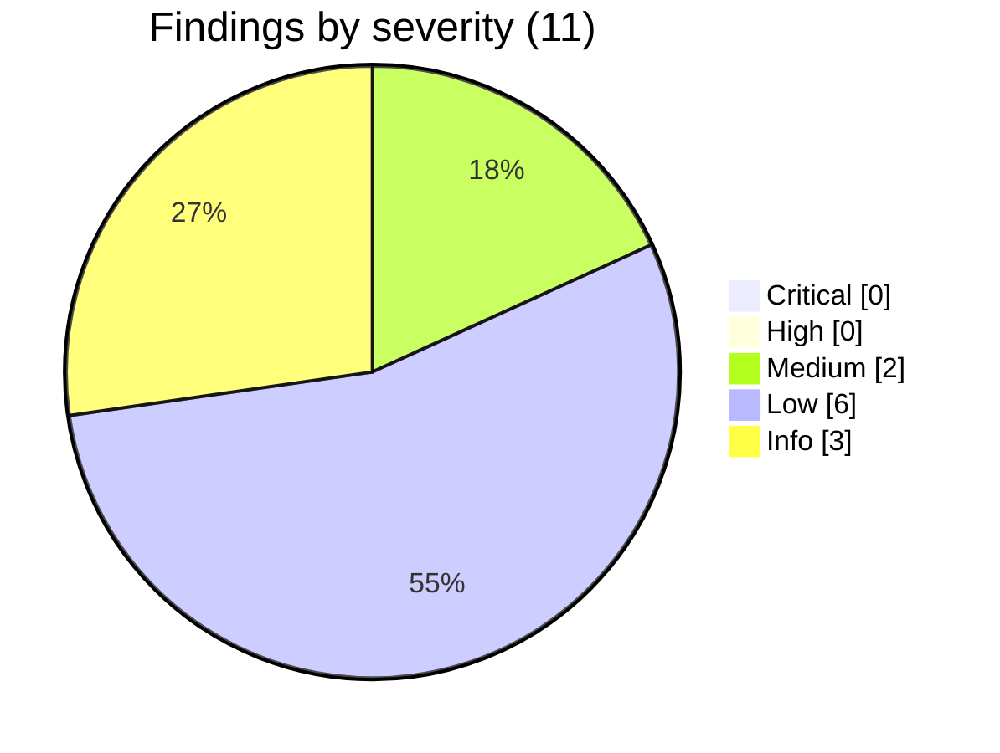
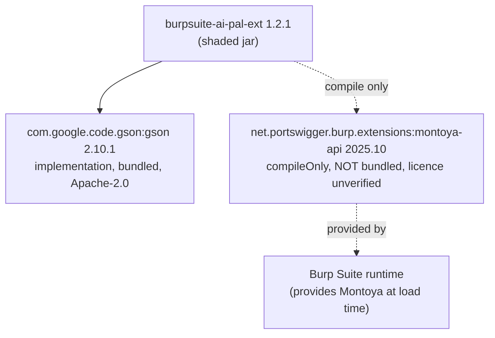
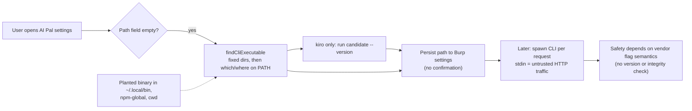

# Supply Chain Security Review: AI Pal Burp Suite extension v1.2.1

Status: **draft**. Every item inherited from secreview was re-checked against the current tree or the live registries on 2026-11-09 (local time, UTC-5). Anything I could not check is labelled "unverified".

## 0. Headline results

- No Critical or High supply-chain findings. The bundled dependency set is one library (gson 2.10.1) with no known vulnerabilities, and its jar matches the Maven Central SHA-1.
- **SR-SCA-003 is resolved, and the secreview wording should be corrected.** The committed `gradle-wrapper.jar` is not unknown: its SHA-256 equals the official Gradle wrapper checksum for **7.5 and 7.5.1**. It does not match 8.12, which is why secreview's 8.12 comparison failed. This is a stale (but authentic) wrapper jar, not evidence of tampering. See SC-001.
- The real integrity gaps are in the release path. The shaded jar is **not reproducible** (three consecutive builds gave three different hashes), nothing is signed or checksummed, and the jar I inspected was built from a working tree that differs from tag `v1.2.1` (SC-003).
- The riskiest supply-chain surface is the **runtime CLI toolchain** the extension discovers, persists and executes without version or integrity checks (SC-005).
- There is **no CI/CD pipeline** (no `.github/workflows`). That means there is no pipeline injection path to report. SC-007 lists what a pipeline would need.



## 1. Method, tools and external queries

| Check | Tool / source | Date (local) | Result |
|---|---|---|---|
| Wrapper jar vs official checksums | `https://services.gradle.org/versions/all` (535 entries), then each release's `*-wrapper.jar.sha256` (384 non-snapshot releases fetched, 0 fetch failures) | 2026-11-09 09:40 to 09:44 | Committed jar `91a23940...1e60` matches **7.5, 7.5.1** and the 7.5 RC builds. Does not match 8.12 (`2db75c40...8046`) |
| 8.12 distribution checksum | `gradle-8.12-bin.zip.sha256` from services.gradle.org, compared with the zip in `~/.gradle/wrapper/dists` | 2026-11-09 | Official `7a00d51f...ef03`. Local cached zip is identical |
| Maven Central metadata | `repo1.maven.org/maven2/<g>/<a>/maven-metadata.xml` and `.jar.sha1` files | 2026-11-09 09:45 | See SC-009, SC-010 |
| Vulnerabilities | OSV `POST https://api.osv.dev/v1/query` (Maven ecosystem) for gson 2.10.1, montoya-api 2025.10, gson 2.15.0, `org.gradle:gradle-wrapper` and `gradle-core` 8.12. Control: gson 2.8.5 | 2026-11-09 09:46 | 0 vulnerabilities for all except the control (GHSA-4jrv-ppp4-jm57), so the API works. Only package coordinates were sent |
| Bundled content | Built `gradlew jar` and listed entries with .NET ZipFile | 2026-11-09 | See section 3 |
| Reproducibility | `gradlew clean jar` three times, SHA-256 compared | 2026-11-09 09:45 | 3 different hashes |
| SCA tools | `osv-scanner` is installed, but the project has no lockfile or manifest it parses (Gradle without lockfile). `pip-audit`, `npm audit` and `cargo audit` do not apply. No Gradle SCA plugin is configured | | **Manual**: direct OSV API queries. Coverage of Gradle's own advisories in OSV is unverified |

Side effects: I ran `gradlew clean jar` three times, which rewrote the gitignored `build/` directory. No tracked file was changed apart from these report files.

### secreview inputs: drift and re-verification

| secreview item | secreview said (scan 2026-11-09 09:20) | Re-verified now | Drift / correction |
|---|---|---|---|
| SR-SCA-001 gson 2.10.1 | 0 vulns, latest 2.14.0 | 0 vulns confirmed. Latest on Central is **2.15.0** (metadata `lastUpdated` 2026-10-24) | Latest moved 2.14.0 to 2.15.0 |
| SR-SCA-002 montoya-api 2025.10, compileOnly | 0 vulns, latest 2026.7 | Confirmed, latest 2026.7 (metadata 2026-07-14). Not in the jar | None |
| SR-SCA-003 wrapper | "does not match 8.12 or about 25 other sampled releases" | Full sweep of 384 releases: matches 7.5 and 7.5.1 | **Corrected.** Sampling missed 7.5.x. Authentic but stale, no tampering indicated |
| SR-SAST-011 / SA-009 | line refs `:642,960,1048`, `CliEnvironmentUtil.java:21-22,27,29` | Lines 642 and 960 and CliEnvironmentUtil 21-22, 27, 29 still exhibit. The Kiro auto-persist is now at `LLMSettingsPanel.java:1042-1047` | Kiro path shifted. `KiroClient.java` is untracked (new, uncommitted) |

## 2. Dependency graph



Direct dependencies: 2 (1 bundled). Transitive dependencies: 0 (the gson 2.10.1 POM declares none, and the Gradle cache holds only gson, gson-parent and montoya-api). No phantom dependencies: all five `llm/impl` clients and the settings code import only `com.google.gson.*` and Burp APIs, and gson is declared.

## 3. What the shaded jar actually contains

`tasks.jar` sets `duplicatesStrategy = EXCLUDE`, then adds `runtimeClasspath` directories and `zipTree` of every runtime jar. Observed in `build/libs/burpsuite-ai-pal-ext-1.2.1.jar` (432,080 bytes, 319 entries):

| Content | Count | Origin | Licence |
|---|---|---|---|
| `base`, `config`, `llm`, `llm/impl` (9), `llm/prompts`, `ui/**`, `util`, `Extension.class` | 68 classes | this project | none declared in repo (unverified) |
| `com/google/gson/**` | 217 classes | gson 2.10.1 | Apache-2.0 (from the gson POM) |
| `META-INF/versions/9/module-info.class` | 1 | gson | Apache-2.0 |
| `META-INF/maven/com.google.code.gson/gson/pom.xml` and `pom.properties` | 2 | gson | Apache-2.0 |
| `META-INF/MANIFEST.MF` | 1 (just `Manifest-Version: 1.0`, 25 bytes) | Gradle | n/a |

Collision and signature checks:

- **Signature files**: none (`META-INF/*.SF/.RSA/.DSA/.EC` absent). gson 2.10.1 is not signed, so nothing is broken today. The build does not strip signature files, so adding a signed dependency later would produce an invalid-signature jar. Latent.
- **module-info**: exactly one, at `META-INF/versions/9/`. The manifest has no `Multi-Release: true`, so the JVM ignores it. No collision, no effect. Latent only if a second multi-release dependency is added.
- **Duplicates**: `EXCLUDE` keeps the first copy silently. Currently there are none.
- **Licence texts**: no `LICENSE` or `NOTICE` file from gson is bundled (Apache-2.0 section 4 asks redistributors to include the licence). See SC-004.
- Not bundled, as intended: montoya-api (compileOnly).

## 4. Findings

### [LOW] Build integrity: SC-001 Gradle wrapper jar is authentic but stale, and the distribution is not hash-pinned
- **Package/File**: `gradle/wrapper/gradle-wrapper.jar` (60,756 bytes), `gradle/wrapper/gradle-wrapper.properties:3`
- **Type**: Build tooling integrity. **CWE-494**
- **secreview correlation**: SR-SCA-003 (re-verified, **conclusion changed**)
- **Tool confirmation**: manual comparison against the Gradle public checksum service
- **Evidence**: committed jar SHA-256 `91a239400bb638f36a1795d8fdf7939d532cdc7d794d1119b7261aac158b1e60` equals the official wrapper checksum of Gradle 7.5 and 7.5.1 (and 7.5 RCs). Official 8.12 wrapper checksum is `2db75c40782f5e8ba1fc278a5574bab070adccb2d21ca5a6e5ed840888448046`. `distributionUrl` points to `gradle-8.12-bin.zip` over HTTPS with `validateDistributionUrl=true`, but there is **no `distributionSha256Sum`**. Git history: the wrapper jar arrived with the PortSwigger `ExtensionTemplateProject` copy in the initial commit (2025-03-03), which is the likely source of the old jar. An earlier revision of the file (hash `FD4547F6...CED01`, commit `d74b520`) was not classified and is unverified.
- **Issue**: the wrapper jar is an authentic but old (7.5.x) artifact driving an 8.12 download, and the downloaded distribution is not integrity-checked beyond TLS. I did verify that the 8.12 zip cached on this machine matches the official checksum, but the build file would not detect a different zip.
- **Impact**: a compromised mirror, proxy or CDN response (or a tampered wrapper jar in a future commit) would run arbitrary code at build time. The wrapper jar is also executable code in the repo that reviewers cannot diff.
- **Remediation**: regenerate with `./gradlew wrapper --gradle-version 8.12.1 --gradle-distribution-sha256-sum <value from services.gradle.org>` and commit the result (this also rewrites the jar to a current version); add `gradle/actions/wrapper-validation` to CI. Dependabot's gradle ecosystem may bump the wrapper, but I did not verify that (unverified).

### [LOW] Build integrity: SC-002 No dependency locking or verification metadata
- **File**: `build.gradle.kts:7-14`; absent: `gradle.lockfile`, `gradle/verification-metadata.xml`
- **Type**: Dependency pinning. **CWE-494, CWE-829**
- **Tool confirmation**: manual file inspection
- **Evidence**: `repositories { mavenCentral() }` is the only repository (good: no custom or plugin repositories, no `mavenLocal()`, no HTTP URLs). `settings.gradle.kts` contains only `rootProject.name` (no `pluginManagement` repositories, so plugin resolution defaults to the Gradle Plugin Portal, though only the built-in `java` plugin is used). Versions are exact (`2.10.1`, `2025.10`, no ranges or `+`). There is no lockfile or checksum/signature verification. I confirmed by hand that the cached gson and montoya jars match their Central `.sha1` files today.
- **Issue**: exact versions pin the coordinates but not the bytes. Central artefacts are normally immutable, so the practical risk is low.
- **Impact**: a compromised repository response or proxy could swap the jar undetected on a fresh build.
- **Remediation**: `./gradlew --write-verification-metadata sha256 jar`, commit `gradle/verification-metadata.xml`; optionally `dependencyLocking { lockAllConfigurations() }`.

### [MEDIUM] Release integrity: SC-003 Fat jar is not reproducible, unsigned, and built from a tree that matches no tag
- **File**: `build.gradle.kts:23-27`, git tags `v1.1.0`, `v1.2.0`, `v1.2.1`
- **Type**: Provenance / build integrity. **CWE-494, CWE-353**
- **Tool confirmation**: manual (three-build experiment)
- **Evidence**: three consecutive `clean jar` runs produced `0CC0ACCC...D297`, `5A3751BC...18B1`, `DC6DF490...ABF11` (different bytes; the likely causes are entry timestamps and file order, which the jar task does not normalise; I observed that the MANIFEST entry carries the build time, but did not diff the jars entry by entry). Tags are lightweight (`git cat-file -t` returns `commit`), the inspected commits show signature status `N` (unsigned), and no checksum, signature or provenance attestation exists anywhere in the repo. At review time `git status` shows modified `README.md`, `CLAUDE.md`, `LLMProvider.java`, `LLMSettings.java`, `SettingsManager.java`, `LLMClientFactory.java`, `LLMSettingsPanel.java` and the untracked `KiroClient.java`, so the built jar includes code that is in no tag.
- **Issue**: nobody can rebuild a release and compare it to what was published, and a user cannot verify who built a given jar.
- **Impact**: a tampered or accidentally different jar is indistinguishable from the genuine one. Users who side-load the jar into Burp (README flow) run it with full access to proxied traffic.
- **Remediation**: add to the build file:

```kotlin
tasks.withType<AbstractArchiveTask>().configureEach {
    isPreserveFileTimestamps = false
    isReproducibleFileOrder = true
}
```

Then build releases only from a clean tagged checkout in CI, publish SHA-256 sums, and add signed tags (`git tag -s`), a signature on the jar, and a build provenance attestation.

### [LOW] Packaging: SC-004 Shaded-jar construction is permissive and omits licence text
- **File**: `build.gradle.kts:23-27`
- **Type**: Packaging hygiene. **CWE-1104** (loosely), licence compliance
- **Tool confirmation**: manual (jar listing)
- **Issue**: the task unpacks everything on `runtimeClasspath` without excluding `META-INF/*.SF|*.RSA|*.DSA`, `META-INF/versions/**/module-info.class` or `module-info.class`; duplicates are dropped silently; gson's Apache-2.0 licence text is not included; the project itself has no declared licence (unverified: no `LICENSE` file in the file tree). The `from(... filter { it.isDirectory })` line is unusual but harmless here.
- **Impact**: none today (section 3). A future signed or modular dependency would yield a jar that fails to load or verify.
- **Remediation**: add `exclude("META-INF/*.SF", "META-INF/*.DSA", "META-INF/*.RSA", "module-info.class", "META-INF/versions/*/module-info.class")`; include `LICENSE`/`NOTICE` for gson and for the project itself.

### [MEDIUM] Runtime trust: SC-005 External CLI toolchain (claude, codex, kiro-cli, ollama) is discovered, persisted and executed with no integrity or version check
- **File**: `LLMSettingsPanel.java:642, 960, 1042-1047, 1066, 1215-1275`; `util/CliEnvironmentUtil.java:18-35`; `config/LLMSettings.java:248-253`; `README.md:137-157`
- **Type**: Runtime supply-chain trust surface. **CWE-426, CWE-427, CWE-494, CWE-829**
- **secreview correlation**: SR-SAST-011, SR-SAST-012, SA-009 (re-verified, see below)
- **Tool confirmation**: manual
- **Discovery (verified in code)**: `findCliExecutable` checks fixed locations first, including user-writable ones (`~/.local/bin`, `~/.npm-global/bin`, `~/.nvm/current/bin`, `%APPDATA%\npm\<name>.cmd`), then runs `which`/`where <name>` on the inherited PATH with no working directory set. The first match is written into the text field and **persisted** to settings with no confirmation (`:642` claude, `:960` codex, `:1042-1047` kiro). Ollama uses a fixed list in `findOllamaExecutable` (`:271-296`).
- **Execution on discovery**: for kiro-cli, `isLikelyKiroCliBinary` **runs the candidate with `--version` at panel construction** (`:1066-1067`, `:1087-1118`). So a binary planted at a discovered location is executed before the user acts. The check accepts any binary that exits 0 with one line of output.
- **Validation**: `LLMSettings.java:248-253` treats a provider as configured if `File.canExecute()` is true. There is no version gate, no hash or signature check, and no capability test. The security model (tools disabled via `--tools ""`, `--sandbox read-only`, `features.shell_tool=false`, per release notes) depends on how each vendor CLI version interprets those flags. A future CLI release that renames or drops a flag would silently remove the control.
- **PATH handling**: `CliEnvironmentUtil.java:21-22` appends user-writable directories; `:29` hard-codes `:` as separator, which corrupts the last PATH entry on Windows (`;`); `:27` is a substring `contains` check.
- **Install guidance**: the README tells users to run `curl -fsSL https://claude.ai/install.sh | bash` (`README.md:139`) and unpinned global npm installs (`npm install -g @anthropic-ai/claude-code`, `@openai/codex`; also hard-coded in UI strings at `LLMSettingsPanel.java:602, 920`). No version, no hash. This is advice, not code, but it is the supply-chain entry point for the toolchain. I did not review those vendors' packages (unverified).
- **Ollama**: `ollama pull <model>` and `ollama run <model>` are launched with a model name from settings (`:394, :468`). Model weights come from the Ollama registry by mutable tag, with no digest pin. Not re-read in depth (consistent with SR-SAST-012 being partly re-verified).
- **Impact**: an attacker with user-level write access to one of those directories, or a malicious package installed via the unpinned npm path, gets code execution and also receives full proxied HTTP traffic on stdin. The added exposure beyond existing user access is modest, hence Medium rather than High.
- **Remediation**: require the user to confirm a discovered path (no auto-persist); do not execute candidates during discovery; resolve names without the current directory; use `File.pathSeparator`; record the binary's version and SHA-256 when a path is first accepted, warn on change; set a minimum supported version per CLI; add a startup canary proving tools are really disabled; pin install instructions to a version/hash.



### [LOW] Dependency automation: SC-006 Dependabot covers Gradle only
- **File**: `.github/dependabot.yml:1-6`
- **Type**: Update hygiene
- **Evidence**: one entry, `package-ecosystem: "gradle"`, `directory: "/"`, `interval: "monthly"`. No `github-actions` ecosystem, no grouping, no security-update configuration. It was added in the very first commit and last changed 2025-03-04 (monthly).
- **Issue**: the Gradle ecosystem is present. GitHub Actions is **not**, which is harmless today (no workflows) but would leave any future workflow's actions unmanaged. Monthly cadence delays version updates (security updates are driven by repo settings, not by this file; setting state not verified).
- **Evidence of effect**: gson is five minor releases behind (2.10.1 vs 2.15.0) and montoya-api is four releases behind (2025.10 vs 2026.7), consistent with updates not being adopted.
- **Remediation**:

```yaml
version: 2
updates:
  - package-ecosystem: "gradle"
    directory: "/"
    schedule: { interval: "weekly" }
  - package-ecosystem: "github-actions"
    directory: "/"
    schedule: { interval: "weekly" }
```

### [INFO] CI/CD: SC-007 No CI/CD pipeline exists (advisory, no injection path)
- **File**: `.github/` contains only `dependabot.yml`; there is no `workflows/` directory (verified by listing and by `git ls-files`)
- **Type**: Absence of control. Not an exploitable finding: there is no workflow, trigger, token or secret to attack, so there is nothing to show an injection path for.
- **Consequence**: no automated build, test, SCA, or release step. Releases are built on a developer machine (SC-003). `docs/development-best-practices.md` and `CLAUDE.md` are described by the architecture review as stale (SA-013), and `docs/` is listed in `.gitignore:42` yet tracked by git, so it is neither reliably private nor maintained.
- **If a pipeline is added, it needs**:
  - Third-party actions pinned to a full commit SHA, never `@main` or `@v1`; Dependabot `github-actions` to refresh them (SC-006).
  - A top-level `permissions: contents: read` with job-level elevation only where needed; no `pull_request_target` checking out PR code; no `${{ github.event.* }}` interpolated into `run:` (pass via `env:`); no secrets on fork PRs.
  - `gradle/actions/wrapper-validation` before any Gradle execution (SC-001).
  - Build from a clean, signed tag with `--no-daemon`, reproducible-archive settings (SC-003), dependency verification on, and a SBOM step.
  - Provenance: `actions/attest-build-provenance` (SLSA) and a published SHA-256 file; release uploads by a protected environment with required review.
  - SCA in CI (osv-scanner or Dependency-Check on the lockfile) failing on known-exploitable issues.

### [LOW] Release process: SC-008 `release/` holds stale release notes only (no binaries, no checksums, no signature)
- **File**: `release/v1.1.0/RELEASE_NOTES.md`
- **Type**: Release hygiene
- **Evidence**: the directory contains one file, 1,767 bytes of Markdown. A search of **all** git history (44 commits) for `.jar/.zip/.exe/.dll/.class/.asc/.sig/.sha*` found only the two `gradle-wrapper.jar` paths. **No binary release artefact has ever been committed**, so the engagement note "stale binaries vs build 1.2.1" is inaccurate: the stale item is the *notes*, not binaries. (Release binaries may exist as GitHub Releases on `origin`; not reachable from this review and therefore unverified.)
- **Staleness**: notes describe v1.1.0 (Claude/Codex CLI). `build.gradle.kts` is 1.2.1, tags `v1.2.0` and `v1.2.1` exist, and the notes do not mention Kiro, Bedrock or later security changes. There are no SHA-256 values and no signature. README says the output is `build/libs/burpsuite-ai-pal-ext.jar` but the Gradle build produces `burpsuite-ai-pal-ext-1.2.1.jar` (documentation drift).
- **Remediation**: one release-notes file per tag, each with the jar name, SHA-256, and a signature or attestation reference; drop or archive the stale directory.

### [INFO] Dependency health: SC-009 gson 2.10.1 has no known vulnerabilities but is behind
- **Package**: `com.google.code.gson:gson@2.10.1` (direct, bundled, reachable)
- **CVE/CWE**: none found (OSV 2026-11-09, control query OK)
- **secreview correlation**: SR-SCA-001
- **Reachability**: `JsonParser.parseString` is called on CLI stdout and HTTP response bodies in `OllamaClient`, `BedrockClient`, `ClaudeCodeClient`, `CodexClient` and `KiroClient` (the last is untracked). Input is therefore partly untrusted (model or CLI output), so the library is on a live path, though no vulnerability exists to exploit.
- **Health**: published to Central, SHA-1 matches Central. Latest is 2.15.0 (2026-11-09 lookup; secreview recorded 2.14.0). Maintained by Google (maintainer-change data not checked: unverified). Not typosquatted: coordinates `com.google.code.gson:gson` are the canonical ones. No abandonment signals found.
- **Remediation**: move to the current release (2.15.0 or latest after review), enable verification metadata (SC-002).

### [INFO] Dependency health: SC-010 montoya-api 2025.10 is four releases behind (compileOnly)
- **Package**: `net.portswigger.burp.extensions:montoya-api@2025.10`
- **CVE/CWE**: none (OSV 0 results). **secreview correlation**: SR-SCA-002
- **Evidence**: not bundled, so it adds no code to the artefact; it fixes the minimum Burp API level. Later versions exist (2025.11, 2025.12, 2026.2, 2026.4, 2026.7). The POM has no licence element (unverified licence).
- **Remediation**: update when the extension needs newer API surface (including the AI APIs, see SC-011), after checking compatibility with the minimum supported Burp version.

### [LOW] BApp Store: SC-011 Build and dependency posture versus BApp acceptance criteria
- **File**: `docs/bapp-store-requirements.md` (note: `docs/` is in `.gitignore:42` but tracked)
- **Type**: Distribution requirements
- **What the document says**: criterion 4 (include all dependencies), criterion 11 (reference `montoya-api` via Gradle or Maven), criterion 12 (use the Montoya API for AI features, so users do not configure third-party keys or services), criterion 7 (use Burp networking), criterion 8 (offline support).
- **What it does not say**: there is **no reproducible-build, checksum, signing, SBOM or provenance requirement** in this document. So I cannot claim the BApp Store mandates reproducibility from this source; PortSwigger's current submission rules elsewhere were not checked (unverified).
- **Assessment against the document**:
  - Criterion 4: met for libraries (gson bundled). The CLI tools are external, so the extension does not include "all dependencies" for those providers.
  - Criterion 11: met (Gradle, `compileOnly`).
  - Criterion 12: **not met by design.** The extension connects to Bedrock, Ollama and vendor CLIs with user-supplied keys. This is a distribution-risk finding more than a vulnerability, and it directly increases the third-party supply-chain surface in SC-005.
  - Criteria 7 and 8: out of supply-chain scope (see secreview).
- **Remediation**: if BApp submission is intended, add reproducible builds and release checksums anyway (SC-003), and plan a Montoya-AI-based provider.

## 5. Prioritised recommendations

1. **SC-003** make the jar reproducible, build from a clean signed tag, publish SHA-256 and an attestation. Cheapest high-value change is the two-line `AbstractArchiveTask` block.
2. **SC-005** stop auto-persisting and auto-executing discovered CLIs; record version/hash on acceptance; add a minimum-version gate and a "tools really disabled" canary.
3. **SC-001, SC-002** regenerate the wrapper with `distributionSha256Sum`; add `verification-metadata.xml`.
4. **SC-006, SC-007** add the `github-actions` ecosystem and create a minimal hardened workflow before any CI is introduced.
5. **SC-004, SC-008, SC-009, SC-010, SC-011** housekeeping: licence files, module-info/signature excludes, update gson, refresh release notes.

## 6. Coverage and limits

- Not run: a Gradle-native SCA tool (none configured); GitHub-side settings (secret scanning, Dependabot security updates, branch protection, Releases) because `origin` was not queried; vendor CLI package review (claude, codex, kiro-cli, ollama); maintainer-change and download-count data for gson.
- Typosquatting: with only gson and montoya-api as direct dependencies, both with canonical coordinates, there is no evidence of typosquatting. I did not search the registry for look-alike names, so absence of alerts is not a negative scan.
- Dependency confusion: both pinned versions resolve on public Maven Central (`2.10.1` and `2025.10` present in `maven-metadata.xml`), so there is no unresolvable-version finding.
- Unverified: whether Dependabot's gradle ecosystem updates the wrapper; contents of `origin`'s GitHub Releases; the earlier wrapper-jar revision `FD4547F6...`.
- Quality gate (pass criteria: SBOM generated, all Critical deps have reachability confirmed): SBOM generated (`sbom.json`); there are no Critical dependencies. Output status is **draft**.
