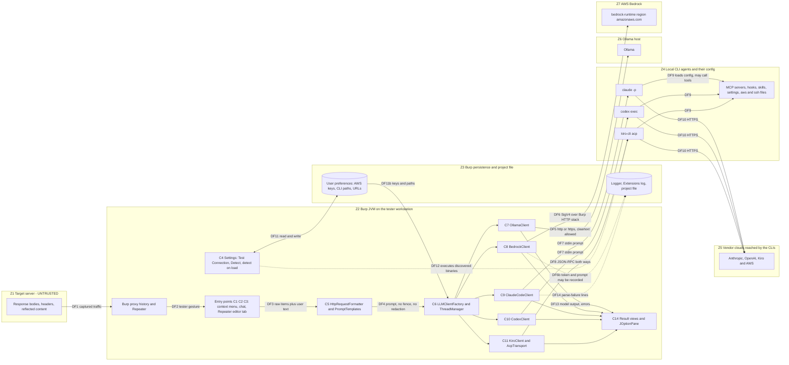
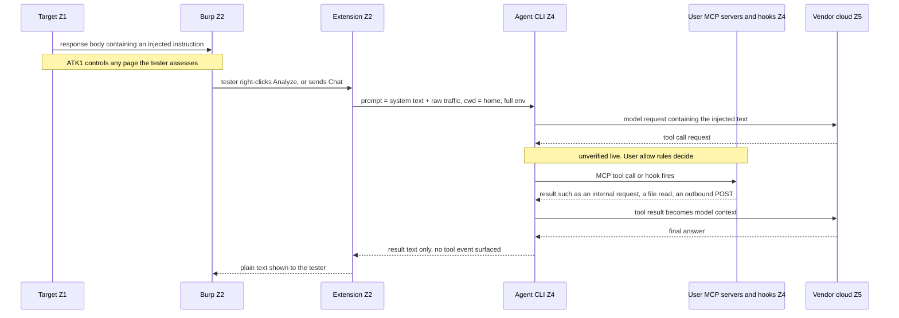
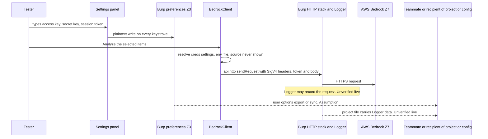
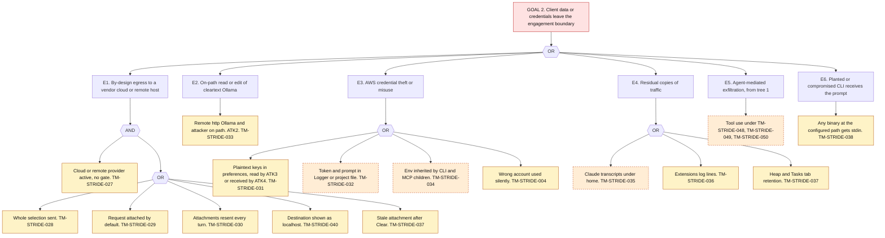
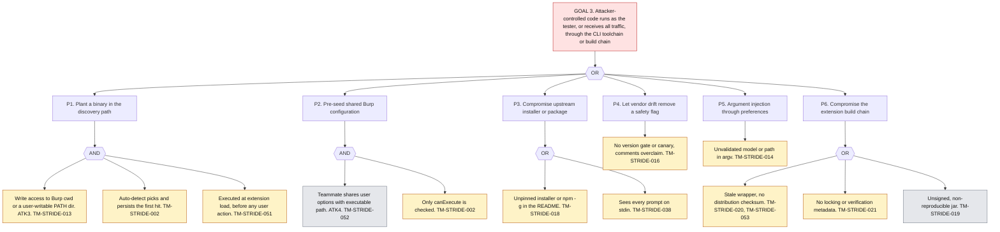
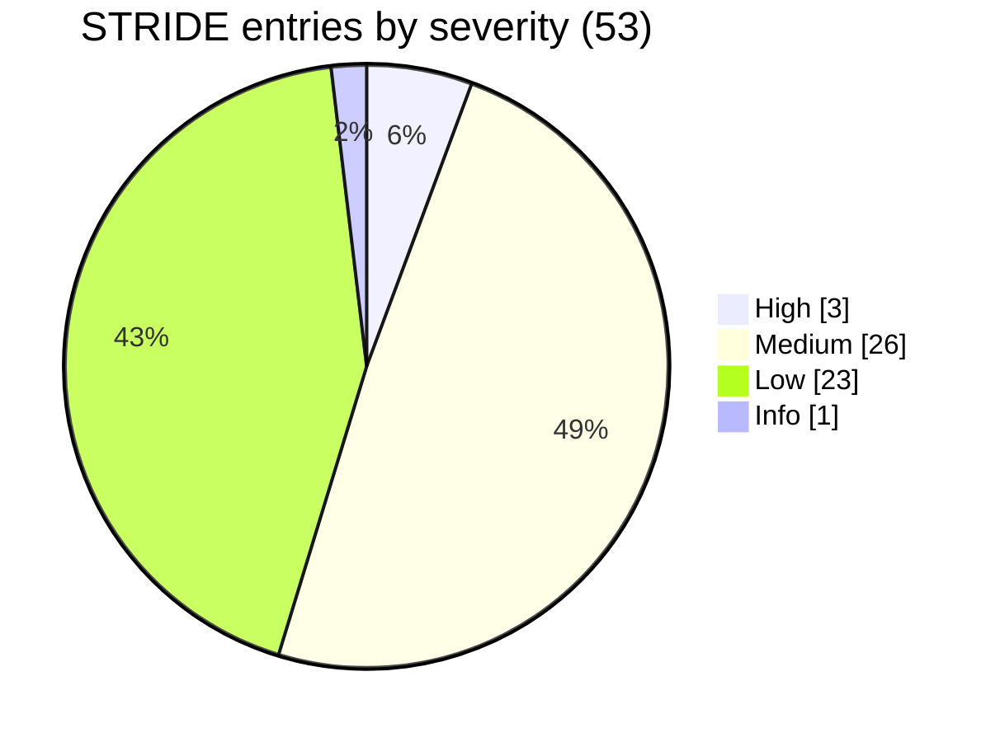

# Threat Model: Burp Suite AI Pal extension (burpsuite-ai-pal-ext)

## 1. Executive summary

This model covers the Burp Suite AI Pal extension (v1.2.1 plus the uncommitted Kiro/ACP work) as a thick-client Swing extension: untrusted HTTP traffic from a target flows through a prompt builder into five LLM backends (Ollama, Bedrock, Claude Code, Codex, Kiro), three of which are local agent CLIs that run with the tester's own configuration. It records 53 STRIDE entries over 15 components (3 High, 26 Medium, 23 Low, 1 Info, 0 Critical). 49 of 53 entries are corroborated by at least one secreview, skill-reviewer or supply-chain finding, and 4 rest only on the architecture review or on my own reading of the source.

The three High entries are the three architecture Highs, and they chain:

- **TM-STRIDE-048** (SA-001, SR-SAST-001): the best-evidenced capability gap: it is confirmed in code. A hostile response body can reach a Claude Code process whose MCP servers, hooks and settings load from the home directory. Whether it can act is unverified live (RU-1, RU-2). If a lab run shows an allowed MCP tool executing under the shipped flags, this entry should be re-rated Critical.
- **TM-STRIDE-007** (SA-003, SR-SAST-003): no instruction/data separation anywhere in the prompt path. On its own it threatens analysis integrity. With TM-STRIDE-048 it becomes a route to action.
- **TM-STRIDE-027** (SA-004, SR-SAST-004): certain by design. Every header and body goes to the active provider with no redaction, scope check, consent or preview, and the destination shown for three providers is wrong (TM-STRIDE-040).

**Input drift that changes the picture.** `KiroClient.java` has been rewritten since the secreview delta: it now launches `kiro-cli acp` and speaks JSON-RPC over stdio, and the `chat --no-interactive --trust-tools ""` command that SR-SAST-020, -023 and -024 describe no longer exists. I re-based those findings instead of citing them as written (section 3). No scan has covered the ACP rewrite, so the Kiro entries (TM-STRIDE-050, TM-STRIDE-017, TM-STRIDE-042, TM-STRIDE-005) rest on my own read of the current source and are labelled that way.

Top cut points, each of which breaks more than one attack tree: (1) isolate the agent processes (temporary working directory, scrubbed environment, MCP/hooks/settings off, tool-event canary), (2) a pre-send egress gate with correct destination labelling and default redaction, (3) stop auto-persisting and auto-executing discovered CLI paths. Section 13 lists all nine recommendations.

Nothing here was tested live. There is no live target, no plan to attack a third party, and seven items remain unverified live; section 12 gives the lab test for each.

## 2. Scan coverage and input provenance

| Source | Status | What it contributes |
|---|---|---|
| secreview SAST | Reused, not re-run (instruction for this phase) | SR-SAST-001..017 (`secreview-report.md`), SR-SAST-018/019 (`coverage-closure.md`), SR-SAST-020..026 (`kiro-delta.md`, written against an earlier KiroClient). Semgrep returned 0 results, so every SR-SAST finding is manual-only. |
| secreview SCA | Reused, not re-run | SR-SCA-001..003 (`sca-results.json`): gson 2.10.1 and montoya-api 2025.10 with no known vulnerability; SR-SCA-003 later corrected by SC-001. |
| security-architecture | Reused | SA-001..013 (3 High, 6 Medium, 4 Low); trust-zone map Z1 to Z7; design options. |
| skill-reviewer | Reused | SKR-PI-001..004, SKR-EXFIL-001, SKR-META-001/002; verdict CAUTION; not hash-reproducible. |
| supply-chain | Reused | SC-001..011; no Critical or High; SBOM; CLI toolchain is the riskiest surface. |

**Delegation note.** The agent rule is to delegate SAST/SCA to secreview before drafting. Per the instruction for this phase I did not start a new scan; the existing secreview outputs are the delegation result. That is a deviation from the normal workflow and is recorded in the gate checklist. The consequence is that code added after the delta (the ACP rewrite) is covered by no scan.

**Scan limits that carry into this model:** no live Burp, no `claude`, `codex`, `kiro-cli` or `ollama` on the review host; Semgrep and OSV results are inherited; the skill-reviewer could not run its pre-filter or record hashes.

## 3. Verification baseline and input drift

Every input is a point-in-time claim. I re-checked each finding I cite against the current tree by reading or grepping the cited symbol, and I cite by symbol and line because the tree is dirty and lines drift. A claim I did not re-check is labelled "Unverified (inherited)".

| Item | Value |
|---|---|
| HEAD | `e44b24f44b9f3bfcd8b1b5bc984ebb80ae6693c4` ("chore: bump version to v1.2.1") |
| Working tree | Dirty: 7 modified (`CLAUDE.md`, `README.md`, `LLMProvider`, `LLMSettings`, `SettingsManager`, `LLMClientFactory`, `LLMSettingsPanel`), untracked `KiroClient.java` (377 lines), `AcpTransport.java` (270 lines), `reports/` |
| Drift markers (line counts) | `LLMSettingsPanel.java` 1433 (secreview 1205, architecture review 1368 then 1411), `KiroClient.java` 377 (delta report 329) |
| Checks performed | Reads of `KiroClient`, `AcpTransport`, the `buildCommand`/`startCodexProcess` regions, settings-panel discovery and dialog regions, plus targeted greps and line lookups across `src`. Wrapper jar SHA-256 recomputed. No build, no tests, no new scan. |

### 3.1 What changed since the inputs

| # | Change in the tree | Effect on inputs |
|---|---|---|
| 1 | **`KiroClient` rewritten to ACP.** It runs `<path> acp [--model M]` and drives `initialize`, `session/new`, `session/prompt` over JSON-RPC (`KiroClient` `:173-178`, `:229-243`, `:289`). Permission requests are answered `outcome: cancelled` (`:327-336`). No `--no-interactive`, `--trust-tools` or stdin `-` remains. | SR-SAST-020 (flag semantics), SR-SAST-023 (stdin-first, per-request probe, timeout that cannot fire) and SR-SAST-024 (`-` sentinel) are superseded in their original form; their residual concerns are carried by TM-STRIDE-050, TM-STRIDE-042, TM-STRIDE-005. SR-SAST-021 (cwd home, full env) still holds. SA-002's Kiro half is re-based. `README.md:171` and `CLAUDE.md:37` now describe the ACP design. |
| 2 | `SettingsManager` Bedrock writes moved to `:113-115`; the Kiro load/save blocks added. | SR-SAST-005 line numbers (the delta report already corrected these). |
| 3 | The `JOptionPane` sinks are at `LLMSettingsPanel` `:1386-1395`. `:1373` is the `SwingWorker` creation line. | SR-SAST-010 and the SA-011 reference to `:1373` are stale; the finding stands. |
| 4 | Auto-detect for Kiro still probes the candidate with `--version` at panel construction (`:1044-1050`, `:1085`), but the Detect button (`:1190-1212`) does not probe. | SR-SAST-022 holds. The README statement that Detect refuses the IDE launcher (`README.md:325`) is not true of the Detect path. |
| 5 | The per-request `guardAgainstIdeBinary` probe no longer exists; `getVersion()` is used by Test Connection only. | Part of SR-SAST-023 is gone. |

### 3.2 Verification status of the 60 inherited findings

| Status | Count | Meaning |
|---|---|---|
| Verified in current source | 34 | Cited symbol and line re-read in the current tree and the claim holds. |
| Code verified, runtime unverified live | 8 | Code re-read and the claim holds in code; the runtime behaviour it depends on has not been observed. |
| Partly verified | 6 | Some sub-claims re-read, others carried over from the input. |
| Superseded by tree change (re-based) | 4 | The code the finding describes has changed; the finding was re-based, not cited as written. |
| Unverified (inherited) | 8 | Not re-checked here (registry data, git history, `docs/` contents). |

## 4. Scope, assets, trust zones and attackers

### 4.1 Scope

- **In scope:** `src/main/java` (all 41 Java files, including the untracked Kiro/ACP files), `build.gradle.kts`, Gradle wrapper, `.github/dependabot.yml`, `CLAUDE.md`, README install guidance, and the external CLI toolchain as a trust dependency (`claude`, `codex`, `kiro-cli`, `ollama`).
- **Out of scope:** `release/v1.1.0` (engagement manifest), vendor cloud internals (Anthropic, OpenAI, Kiro, AWS: treated as honest-but-curious recipients, so their retention and training policies are a compliance question, not modelled as an adversary), Burp's own security, the contents of the vendor CLI packages, and `docs/` (gitignored at `.gitignore:42`, stale per SA-013).

### 4.2 Assets

| ID | Asset | Why it matters |
|---|---|---|
| A1 | Client traffic and credentials in captured HTTP (cookies, bearer tokens, PII, bodies) | Confidentiality duty to the client; the data the extension is designed to move. |
| A2 | AWS access key, secret key, session token; vendor CLI logins and `KIRO_API_KEY` | Long-lived credentials with Bedrock rights, in plaintext preferences. |
| A3 | The tester's workstation and the files and network it can reach (`~/.aws`, `~/.ssh`, internal hosts) | An agent or planted binary runs as the tester. |
| A4 | MCP and agent configuration (`~/.claude`, `CODEX_HOME/config.toml`, `~/.kiro`: servers, hooks, skills, settings) | Defines what a hijacked agent can do. May include a Burp MCP server. |
| A5 | Engagement confidentiality and scope integrity | Cross-client leakage and out-of-scope data sent to third parties are contractual and reputational events. |
| A6 | Analysis integrity (findings and suggested payloads) | A manipulated answer hides real flaws or misdirects the tester. |
| A7 | Burp user configuration and project file | Carry A1 and A2 to teammates and recipients. |
| A8 | Availability of LLM features and Burp UI responsiveness | Three hung runs disable all features. |
| A9 | Extension release integrity | The jar runs inside Burp with access to all proxied traffic. |

### 4.3 Trust zones

| Zone | Contents | Trust | Assets |
|---|---|---|---|
| Z1 | Target server: response bodies, headers, reflected request content | **Untrusted.** Controlled by whoever runs any page the tester assesses | — |
| Z2 | Burp JVM on the tester workstation: extension code, Swing UI, Montoya API | Trusted; holds the client data | A1, A5, A6, A8 |
| Z3 | Burp persistence and project file: preferences, Logger, Extensions log | Trusted at rest; often shared with teammates or clients | A2, A7 |
| Z4 | Local CLI agents and their config: `claude`, `codex`, `kiro-cli`, MCP servers, hooks, `~/.aws`, `~/.ssh` | **High privilege**, not owned by the extension; runs as the tester | A3, A4 |
| Z5 | Vendor clouds reached by the CLIs: Anthropic, OpenAI, Kiro, AWS | Third party; receives client data | A1 |
| Z6 | Ollama host: `localhost` by default, any LAN or remote host over `http://` accepted | Variable | A1 |
| Z7 | AWS Bedrock: `bedrock-runtime.<region>.amazonaws.com`, SigV4 | Third party; receives client data | A1, A2 |

### 4.4 Attackers

| ID | Attacker | Capability | Reaches |
|---|---|---|---|
| ATK1 | Hostile target site | Controls bodies, headers and reflected content in Z1. No direct access to the tester. | Prompt content (TM-STRIDE-007, TM-STRIDE-001), then agent capability (TM-STRIDE-048 and peers); output content (TM-STRIDE-008) |
| ATK2 | Network attacker against cleartext Ollama | On-path read and modify of `http://` traffic to a remote Ollama host. | Traffic confidentiality, response integrity, dialog content (TM-STRIDE-012) |
| ATK3 | Local low-privilege user or process | Reads user-readable files; writes to shared or user-writable directories (Burp cwd, PATH entries). | Preferences, transcripts, planted binaries |
| ATK4 | Malicious teammate or recipient of the project file or exported config | Receives A2 and A7; can supply a configuration that the tester imports. | Plaintext keys, Logger/project data, pre-seeded paths and endpoints |
| ATK5 | Compromised or MITM'd CLI or toolchain | Controls a binary at the configured path, or a package or installer the README tells users to run, or the build chain. | Full prompt on stdin, forged output, code execution as the tester |

## 5. Architecture and data flows

All inbound surface is the tester's own gestures and settings. The extension opens no listener (grep for `ServerSocket`, `HttpServer`, `DatagramSocket` returned none); every network channel is outbound and every local channel is a child process or Burp's API.

### 5.1 Component inventory

| ID | Component | Zone | Code |
|---|---|---|---|
| C1 | Context-menu provider | Z2 | `ui/contextmenu/LLMContextMenuProvider.java` (Analyze, Explain, Attack Vectors, Custom Prompt) |
| C2 | Chat | Z2 | `ui/chat/ChatPanel`, `ChatSessionPanel`, `ConversationHistory`, `ChatMessage` |
| C3 | Repeater editor tab | Z2 | `ui/editor/LLMSecurityAssistantEditorPanel` and the request/response editor providers (Repeater only) |
| C4 | Settings panel and SettingsManager | Z2/Z3 | `ui/settings/LLMSettingsPanel` (Test Connection, Detect, detect-on-load), `config/*` |
| C5 | Prompt assembly | Z2 | `util/HttpRequestFormatter`, `llm/prompts/PromptTemplates` |
| C6 | Dispatch | Z2 | `llm/LLMClientFactory`, `util/ThreadManager` (3 threads, unbounded queue), `ui/tasks/AITaskManager` |
| C7 | Ollama backend | Z2 to Z6 | `llm/impl/OllamaClient` (two network stacks) |
| C8 | Bedrock backend | Z2 to Z7 | `llm/impl/BedrockClient`, `util/AwsCredentialsUtil` (hand-rolled SigV4 via `api.http()`) |
| C9 | Claude Code backend | Z2 to Z4 | `llm/impl/ClaudeCodeClient` (`claude -p`, prompt on stdin) |
| C10 | Codex backend | Z2 to Z4 | `llm/impl/CodexClient` (`codex exec`, prompt on stdin) |
| C11 | Kiro backend (ACP) | Z2 to Z4 | `llm/impl/KiroClient`, `llm/impl/AcpTransport` (`kiro-cli acp`, JSON-RPC over stdio, both directions). Untracked in git |
| C12 | CLI discovery and environment | Z2/Z4 | `util/CliEnvironmentUtil`, `findCliExecutable` / `findExecutableOnPath` / `findKiroExecutable` in the settings panel |
| C13 | State and log stores | Z2/Z3 | Burp preferences, Extensions log, Logger and project file, `AITaskManager`, `ConversationHistory` |
| C14 | Output rendering | Z2 | `AnalysisResultDialog`, `ChatPanel` pane, `AITasksTab`, `JOptionPane` in the settings panel |
| C15 | Build and release | build host | `build.gradle.kts`, Gradle wrapper, `.github/dependabot.yml`, shaded jar, README install guidance |

### 5.2 The five backends compared

| Backend | Channel and command (current source) | Real destination | Agent capability | Confinement in source | cwd and env | Persistence |
|---|---|---|---|---|---|---|
| Ollama | `HttpURLConnection` (streaming `:140`) and `api.http()` (non-streaming `:264`) | Z6, default `localhost:11434`, any host, cleartext allowed | None: no tools in request body | Not needed | n/a | None by extension |
| Bedrock | `api.http().sendRequest` with hand-rolled SigV4 (`:166-233`) | Z7, host pinned to `*.amazonaws.com` (`:166`) | None: no tools in request body | Not needed | n/a | Burp Logger and project (unverified live) |
| Claude Code | `claude -p --output-format json\|stream-json --model M --tools "" --allowedTools ""`, prompt on stdin (`:305-327`) | Z5 Anthropic, via the CLI | Full agent. MCP, hooks, skills, settings load | Built-in tools only. No MCP deny, no strict MCP config, no `--no-session-persistence` | cwd home, full env | Transcripts under `~/.claude` |
| Codex | `codex exec --json --ephemeral --skip-git-repo-check --sandbox read-only -c features.shell_tool=false -c web_search=disabled -m M -`, prompt on stdin (`:272-292`) | Z5 OpenAI, via the CLI | Agent with read-only FS and user `config.toml` | Sandbox read-only, shell tool and web search off. No `--ignore-user-config` | cwd home, full env | `--ephemeral` |
| Kiro | `kiro-cli acp [--model M]`, JSON-RPC 2.0 over stdio, bidirectional (`KiroClient` `:173-199`, `AcpTransport`) | Z5 Kiro and AWS models, via the CLI | Agent with whatever `~/.kiro` config enables (unverified live) | Client cancels every `session/request_permission`; advertises no fs/terminal capability; `mcpServers` empty (`:229-243,327-336`) | cwd home (`:191,242`), full env incl. `KIRO_API_KEY` | Unverified |

### 5.3 Data flow diagram

| Flow | From to | Data | Channel and control today | Threats |
|---|---|---|---|---|
| DF1 | Z1 to Burp | Captured traffic | Burp proxy. Untrusted | TM-STRIDE-007, TM-STRIDE-001 |
| DF2 | Burp to entry points | Selected items, user prompt | Tester gesture | TM-STRIDE-027, TM-STRIDE-028 |
| DF3 | Entry points to C5 | Raw items (all headers, body up to 10,000 chars) | In process. No redaction, scope check or consent | TM-STRIDE-027, TM-STRIDE-029, TM-STRIDE-030 |
| DF4 | C5 to C6 to active backend | Template plus raw traffic | In process. No fence, role flattening on CLI backends | TM-STRIDE-007, TM-STRIDE-001, TM-STRIDE-009 |
| DF5 | C7 to Z6 | Prompt, model output | HTTP or HTTPS, no auth, cleartext allowed | TM-STRIDE-003, TM-STRIDE-011, TM-STRIDE-033 |
| DF6 | C8 to Z7 | Prompt, SigV4 headers, session token | HTTPS through Burp's stack | TM-STRIDE-032, TM-STRIDE-004 |
| DF6b | C8 to Logger/project | Token, signature, prompt | Side effect of `api.http()` (unverified live) | TM-STRIDE-032 |
| DF7 | C9, C10 to Z4 | Full prompt on stdin | Argument list, no shell; PATH extended; cwd home | TM-STRIDE-048, TM-STRIDE-049, TM-STRIDE-038 |
| DF8 | C11 to Z4 | `session/prompt`; replies and agent requests | JSON-RPC over stdio. Client cancels permission requests | TM-STRIDE-050, TM-STRIDE-017, TM-STRIDE-042 |
| DF9 | Z4 agent to MCP/hooks/config | Config load, tool calls | Governed by the user's rules, not by the extension | TM-STRIDE-048, TM-STRIDE-049, TM-STRIDE-050, TM-STRIDE-034 |
| DF10 | Z4 agent to Z5 | Prompt, tool results | HTTPS by the CLI | TM-STRIDE-027, TM-STRIDE-034 |
| DF11 | C4 and Z3 | Paths, URLs, AWS secrets | Burp preferences, plaintext, per keystroke | TM-STRIDE-031, TM-STRIDE-052 |
| DF12 | C4 to Z4 | Discovery spawns and `--version` probes | Executed at load for Kiro | TM-STRIDE-051, TM-STRIDE-002 |
| DF13 | Backends to C14 | Model output, provider errors | Plain-text views; `JOptionPane` for Test Connection | TM-STRIDE-012, TM-STRIDE-039, TM-STRIDE-008 |
| DF14 | Backends to Extensions log | Parse-failure lines, errors | `logToError` | TM-STRIDE-036 |
| DF15 | Build host to Z2 | Wrapper, dependencies, shaded jar | Gradle download, Maven Central, side-load | TM-STRIDE-020, TM-STRIDE-021, TM-STRIDE-019, TM-STRIDE-053 |

### 5.4 High-risk flow: hostile body to agent tool use

### 5.5 High-risk flow: credentials and client data

## 6. Attack surface enumeration

Every external interface the extension exposes or consumes, with the threats it carries. "Inbound listeners" is listed to record the negative result.

| ID | Interface | Location (current tree) | Data | Trigger | Threats |
|---|---|---|---|---|---|
| AS-01 | Context menu: Analyze, Explain, Attack Vectors, Custom Prompt | `LLMContextMenuProvider` `:85,111,137,163` | Selected Burp items (Z1 content), user prompt | Tester gesture | TM-STRIDE-007, TM-STRIDE-027, TM-STRIDE-028, TM-STRIDE-009, TM-STRIDE-001 |
| AS-02 | Chat: attach request, send, Clear, Stop | `ChatSessionPanel` `:62-63`; `ChatPanel` `:185,251,282` | Attached traffic, free text, model stream | Tester gesture | TM-STRIDE-027, TM-STRIDE-030, TM-STRIDE-010, TM-STRIDE-037 |
| AS-03 | Repeater request/response editor tab | `LLMSecurityAssistantEditorPanel` `:44,148-173` | Request (default on), response, notes | Tester gesture; Repeater only | TM-STRIDE-029, TM-STRIDE-027, TM-STRIDE-001 |
| AS-04 | Settings: Ollama base URL | `LLMSettings` `:246`; `OllamaClient` `:236-239` | Free-text URL | Local config (or imported config) | TM-STRIDE-003, TM-STRIDE-033, TM-STRIDE-011 |
| AS-05 | Settings: Bedrock keys, session token, region, model | `LLMSettingsPanel` `:806,819,832` | Secrets, free text | Local config | TM-STRIDE-031, TM-STRIDE-004, TM-STRIDE-015 |
| AS-06 | Settings: CLI path and model fields (claude, codex, kiro) | `LLMSettingsPanel` `:593,911,999`; `LLMSettings` `:248-253` | Executable path, model string | Local config (or imported config) | TM-STRIDE-002, TM-STRIDE-014, TM-STRIDE-052 |
| AS-07 | Test Connection and Kiro version test | `LLMSettingsPanel` `:1354-1410`, `:1143-1148` | Provider response text, error text | Tester gesture | TM-STRIDE-012, TM-STRIDE-039, TM-STRIDE-011 |
| AS-08 | Detect buttons and detect-on-load | `LLMSettingsPanel` `:598,916,1004`, `:1190-1212`, `:642,960,1045` | Filesystem and PATH contents | Extension load, tester gesture | TM-STRIDE-002, TM-STRIDE-051, TM-STRIDE-013, TM-STRIDE-024 |
| AS-09 | Helper spawns: `where`/`which`, `<cli> --version`, `ollama list\|pull\|run\|stop` | `LLMSettingsPanel` `:323,394,468,529,1085,1256`; `KiroClient` `:115`; `ClaudeCodeClient` `:199,236`; `CodexClient` `:147,184` | Binary output | Tester gesture or load | TM-STRIDE-043, TM-STRIDE-051, TM-STRIDE-014 |
| AS-10 | Child process: `claude -p` (stdin, stdout, stderr) | `ClaudeCodeClient` `:259-273`, `:305-327` | Full prompt in; model JSON out | Per request | TM-STRIDE-048, TM-STRIDE-034, TM-STRIDE-035, TM-STRIDE-041, TM-STRIDE-038 |
| AS-11 | Child process: `codex exec` (stdin, JSONL out) | `CodexClient` `:272-292` | Full prompt in; JSONL out | Per request | TM-STRIDE-049, TM-STRIDE-034, TM-STRIDE-041 |
| AS-12 | Child process: `kiro-cli acp` (JSON-RPC both directions) | `KiroClient` `:173-199`; `AcpTransport` `:69,156,186` | Prompt in; `session/update`, `session/request_permission`, errors out | Per request | TM-STRIDE-050, TM-STRIDE-017, TM-STRIDE-042, TM-STRIDE-005 |
| AS-13 | HTTP to Ollama, two stacks | `OllamaClient` `:140` (HttpURLConnection), `:264` (`api.http()`) | Prompt, response | Per request | TM-STRIDE-033, TM-STRIDE-011, TM-STRIDE-032 |
| AS-14 | HTTPS to Bedrock via Burp stack, SigV4 | `BedrockClient` `:166-233` | Prompt, signed headers, session token | Per request | TM-STRIDE-032, TM-STRIDE-004, TM-STRIDE-047 |
| AS-15 | Environment variables read and inherited | `AwsCredentialsUtil` (env, `:57`); `CliEnvironmentUtil` `:14-36`; README `KIRO_API_KEY` (`:327`) | AWS_*, KIRO_API_KEY, PATH, proxies | Process start | TM-STRIDE-034, TM-STRIDE-004, TM-STRIDE-013 |
| AS-16 | Files read: `~/.aws/credentials`; by child CLIs: `~/.claude`, `CODEX_HOME/config.toml`, `~/.kiro`, `~/.ssh` | `AwsCredentialsUtil` `:44`; child behaviour inherited | Credentials, MCP/hook/skill config | Per request | TM-STRIDE-004, TM-STRIDE-034, TM-STRIDE-048, TM-STRIDE-049, TM-STRIDE-050 |
| AS-17 | Burp persistence: preferences read and write | `SettingsManager` `:60-125` | Paths, URLs, AWS secrets | Load, every keystroke | TM-STRIDE-031, TM-STRIDE-052, TM-STRIDE-024 |
| AS-18 | Burp logging: `logToError`, Extensions log, Logger via `api.http()` | `ClaudeCodeClient` `:153`; `CodexClient` `:106,241`; `OllamaClient` `:203`; `BedrockClient` `:233` | Traffic-derived lines, tokens | Errors, every provider call | TM-STRIDE-036, TM-STRIDE-032 |
| AS-19 | Output surfaces: result dialog, clipboard copy, chat pane, Tasks tab, `JOptionPane` | `AnalysisResultDialog` `:31,57`; `ChatPanel`; `AITasksTab`; panel `:1386-1395` | Model and provider text | Per response | TM-STRIDE-008, TM-STRIDE-012, TM-STRIDE-039, TM-STRIDE-023, TM-STRIDE-037 |
| AS-20 | Extension lifecycle: load and unload | `Extension` `:29-52`, `:54-57` | Registers menu, tab, editors, tasks | Burp start and unload | TM-STRIDE-037, TM-STRIDE-041, TM-STRIDE-051 |
| AS-21 | Build and release: wrapper download, Maven Central, shaded jar, Dependabot, install docs | `gradle-wrapper.properties` `:3`; `build.gradle.kts` `:7-26`; `README.md:139,143,155` | Distribution zip, jars, installers | Developer build, user install | TM-STRIDE-020, TM-STRIDE-021, TM-STRIDE-019, TM-STRIDE-053, TM-STRIDE-018 |
| AS-22 | Inbound network listeners | none: no `ServerSocket`, `HttpServer` or `DatagramSocket` in `src` (grep) | — | — | No listener threats. The extension has no inbound interface; every channel is outbound or local |

## 7. STRIDE threat register

One row per threat. **Sev** is likelihood times impact for a consultant on a client engagement; **↑** marks an entry whose rating was raised one level because a verified scan or architecture finding corroborates it, as the STRIDE reference requires. **Basis** shows what the evidence is: Verified, Verified in code but unverified live, Design-level, Unverified (inherited), or TM-observed. Entries with no scan finding are design-level and flagged as such. **Atk** uses ATK1 to ATK5 from section 4.4; "—" means a structural or insider issue with no outside attacker.

### 7.1 Spoofing (6)

| ID | Comp | Atk | Threat | Corroboration | Evidence in current tree | Sev | Mitigation |
|---|---|---|---|---|---|---|---|
| TM-STRIDE-001 | C5, C2, C3, C1 | ATK1 | Target content forges the extension's own section and role markers (`=== HTTP Response ===`, `=== Request ===`, line-initial `User:`, `Assistant:`, `System:`) so injected text is indistinguishable from tester or extension instructions. | SA-003, SR-SAST-003, SKR-PI-002, SKR-PI-003, SKR-PI-004 | **Verified.** `HttpRequestFormatter.format` `:15,19`; `LLMSecurityAssistantEditorPanel` `:206,209`; `LLMContextMenuProvider.formatItems` `:209`; role flattening in `ClaudeCodeClient.buildConversationPrompt` `:336`, `CodexClient` `:307,312`, `KiroClient.buildConversationPrompt` `:359`. Ollama and Bedrock use structured roles (not exposed to turn forgery). | Medium ↑ | Per-request random fence; strip the fence and line-initial role tokens from data; JSON-encoded data block for CLI backends (SA-003 option B). |
| TM-STRIDE-002 | C12, C4, C9, C10, C11 | ATK3, ATK5 | A planted or look-alike executable is accepted as `claude`, `codex` or `kiro-cli`: discovery auto-selects and persists the first hit, `where` searches the current directory first on Windows, and validation is `canExecute()` only. | SA-009, SR-SAST-011, SR-SAST-022, SC-005 | **Verified.** Auto-persist `LLMSettingsPanel` `:642` (claude), `:960` (codex), `:1045-1048` (kiro); `findExecutableOnPath` `:1253-1279` (`ProcessBuilder` `:1256`, no working directory set); `LLMSettings` `:248-253`; `CliEnvironmentUtil` `:21-22`. | Medium ↑ | Require explicit confirmation before persisting a path; resolve without the current directory; record version and SHA-256 on first accept and warn on change. |
| TM-STRIDE-003 | C7 | ATK2 | Any host answering at the configured Ollama URL is trusted: cleartext `http://` is prepended silently, there is no authentication, and validation is non-empty only. | SA-007, SR-SAST-007 | **Verified.** `OllamaClient.parseBaseUrl` `:236-239`; `LLMSettings` `:246`. | Medium | Allow cleartext only to loopback; otherwise require `https://` or an explicit per-host confirmation; optional auth header. |
| TM-STRIDE-004 | C8 | — | Client data is sent under the wrong AWS identity: three credential sources with silent precedence (settings, environment, `~/.aws/credentials`), only `AWS_DEFAULT_PROFILE` is honoured (not `AWS_PROFILE`), and the effective source is never shown. | SA-005, SR-SAST-013 | **Verified.** `AwsCredentialsUtil` `:57`; `BedrockClient` `:41` (`credentialSource`), `:91-115` (precedence), `:118` (`getCredentialSource`, zero callers). | Medium | Honour `AWS_PROFILE` first; show effective account and source before the first send of a session. |
| TM-STRIDE-005 | C11, C4 | ATK3, ATK5 | Any executable that passes `canExecute()` and prints one version line is launched as `<path> acp`. The IDE-launcher guard is a line-count heuristic, and Detect skips it, although the README says Detect refuses the IDE launcher. | SR-SAST-024 (residual part only), SR-SAST-022, SA-002 | **Verified.** `KiroClient.looksLikeIdeLauncherOutput` `:139-143`; `LLMSettings` `:252-253`; `openSession` `:173-178`; `detectCliBinary` `:1190-1212` (no `isLikelyKiroCliBinary` call) versus `README.md:325`. | Low | Apply the same guard on every accept path; compare binary name and version regex; fail closed. |
| TM-STRIDE-006 | C15 | ATK5 | Users cannot establish who built a given jar: tags are lightweight and unsigned, nothing is checksummed or attested, and the built tree matches no tag. | SC-003, SC-008 | **Unverified (inherited).** Dirty tree re-verified (`git status`: 7 modified, `KiroClient.java` and `AcpTransport.java` untracked). Unsigned tags and absent attestations are inherited from SC-003. | Low | Signed tags, published SHA-256, provenance attestation, build from a clean tag. |

### 7.2 Tampering (15)

| ID | Comp | Atk | Threat | Corroboration | Evidence in current tree | Sev | Mitigation |
|---|---|---|---|---|---|---|---|
| TM-STRIDE-007 | C5, C1, C2, C3 to C11 | ATK1 | Instruction/data confusion: a hostile response body or header injects instructions that reach the model with no fence and no untrusted-data clause, so analysis can be manipulated (hide the target's own flaws, fabricate findings). | SA-003, SR-SAST-003, SKR-PI-001 | **Verified.** `PromptTemplates.formatAnalysisPrompt` `:233`, `formatExplainPrompt` `:243`, `formatAttackVectorsPrompt` `:253` concatenate `httpContent` raw; no `untrusted` clause in `PromptTemplates.java` (grep returned none). | High ↑ | Defence in depth, in order of dependence: confine the agent (assume the model is compromised, see TM-STRIDE-048), then fence and data-clause, then provenance banner. |
| TM-STRIDE-008 | C14, C5 | ATK1 | The attack-vectors prompt asks for exact payloads; a hostile target can shape the payloads or commands the tester is invited to run next. | SA-011, SR-SAST-003 | **Verified.** `PromptTemplates.ATTACK_VECTORS_SYSTEM` `:126-186` (payload generation `:127-134`). | Medium ↑ | Provenance banner on generated payloads; no auto-copy; tester reviews before use. |
| TM-STRIDE-009 | C1 | ATK1 | Custom Prompt sends no system prompt at all, so not even the formatting guardrail applies to the content that follows the user's text. | SKR-PI-003, SA-003 | **Verified.** `LLMContextMenuProvider` `:174` (`client.complete(fullPrompt, null)`). | Medium | Always send a system prompt that carries the untrusted-data clause. |
| TM-STRIDE-010 | C2, C13 | ATK1 | Chat history integrity is weak: the system message is evicted after 100 messages, and Clear does not cancel an in-flight stream, which then repopulates the cleared history. | SR-SAST-017, SR-SAST-018, SA-010 | **Verified.** `ConversationHistory` `:9` (`MAX_HISTORY_SIZE`), `:28-29,58-59` (`remove(0)`); `ChatPanel.clearChat` `:282-287` (no `stopRequested`, no epoch); `onComplete` path `:224`. | Low | Pin the system prompt; epoch counter that drops stale callbacks. |
| TM-STRIDE-011 | C7 | ATK2 | An on-path attacker alters Ollama requests or responses over cleartext, steering analysis. Redirects are followed on the streaming path. | SA-007, SR-SAST-007 | **Verified.** `OllamaClient` `:138-145` (`HttpURLConnection`, no `setInstanceFollowRedirects` anywhere in the file), `:236-239`. | Medium | As TM-STRIDE-003; `setInstanceFollowRedirects(false)`; one HTTP client for both paths. |
| TM-STRIDE-012 | C14, C4 | ATK2, ATK5 | Provider- or CLI-controlled text is shown in `JOptionPane`; a line starting with `<html>` is rendered as HTML, so a MITM'd Ollama or compromised CLI can craft the dialog. For Kiro, the ACP error message from the child process flows into this dialog. | SR-SAST-010, SR-SAST-026 (caveat re-based), SA-011 | **Verified.** `LLMSettingsPanel` `:1386-1390` (`"Response: " + content`), `:1394-1395` (`"Connection failed:\n" + getErrorMessage()`); the SA/SR cite `:1373`, which is now the worker creation line. Kiro path: `KiroClient.runTurn` `:168-169` and `AcpTransport.request` `:117`. | Low | Show server text in a `JTextArea` or escape it; truncate. |
| TM-STRIDE-013 | C12 | ATK3 | PATH handling: user-writable directories are appended, the separator is hard-coded to `:` (corrupts the last PATH entry on Windows), and the `contains` check is a substring match. | SR-SAST-011, SA-009 | **Verified.** `CliEnvironmentUtil` `:21-22,27,29`. | Low | `File.pathSeparator`; exact-entry match; do not append user-writable directories. |
| TM-STRIDE-014 | C4, C12 | ATK4 | Model and path preference values reach argv unvalidated (argument injection, and on Windows a `.cmd` shim runs through `cmd.exe`). | SR-SAST-012, SR-SAST-025 | **Verified.** `KiroClient` `:178` (`--model`); `CodexClient` `:285`; `ClaudeCodeClient` `:314-315`; `LLMSettings` `:225` (KIRO case); `ollama pull/run/stop` at `LLMSettingsPanel` `:394,468,529`. | Low | Allow-list `^[A-Za-z0-9][A-Za-z0-9._:/@-]*$`; reject a leading `-`; prefer `.exe` targets. |
| TM-STRIDE-015 | C8 | ATK3 | Region and model from preferences are interpolated into host and path without validation. The host suffix is pinned to `.amazonaws.com`, so credentials cannot be sent to another domain. | SR-SAST-013 | **Verified.** `BedrockClient` `:166-168`. | Low | Validate region and model with strict patterns. |
| TM-STRIDE-016 | C9, C10, C11, C12 | ATK5 | Agent confinement rests on how three vendor CLIs interpret flags and protocol messages in versions the extension never checks, and the code, README and CLAUDE.md state stronger guarantees than were tested. | SA-009, SA-013, SR-SAST-001, SR-SAST-020 (re-based), SC-005, SKR-META-001 | **Verified.** Comment `ClaudeCodeClient` `:316-321` ("removes all tools from the agent entirely"); `README.md:171` and `CLAUDE.md:37` (Kiro "no tool ever executes"); no version gate in `LLMSettings` `:248-253`; `src/test` does not exist. | Medium ↑ | Minimum-version gate; startup capability canary that refuses to enable a provider if any tool event appears; correct the comments. |
| TM-STRIDE-017 | C11 | ATK5 | A CLI that dies or times out mid-turn can be reported as a successful, complete analysis: waiters are woken with an empty result, and any collected text is returned as success. | none (TM-observed on the ACP rewrite) | **TM-observed (not in any input).** `AcpTransport.readLoop` `finally` `:178-182`; `KiroClient.prompt` `:289-314` (success on partial output at `:294`, `:306`, `:314`). | Low | Mark partial results visibly; require `stopReason == end_turn` for a clean result. |
| TM-STRIDE-018 | C12, C9, C10, C11 | ATK5 | A compromised upstream package or installer yields a CLI that returns forged output (or forged ACP messages) and sees every prompt. The README tells users to run an unpinned `curl`-pipe-`bash` installer and unpinned `npm -g` installs. | SC-005, SC-011 | **Verified.** `README.md:139` (installer), `:143`, `:155` (`npm install -g`); hard-coded strings `LLMSettingsPanel` `:602,920`. Vendor package contents were not reviewed. | Medium | Pin install instructions to a version and hash; record version and hash at accept time. |
| TM-STRIDE-019 | C15 | ATK5 | The shaded jar is not reproducible, unsigned, and built from a tree that matches no tag, so a tampered or accidentally different jar is indistinguishable from the genuine one. | SC-003, SC-004 | **Unverified (inherited).** `build.gradle.kts` `:22-26` (no reproducible-archive settings, no signature excludes); dirty tree re-verified. The three-build non-reproducibility result is inherited (not re-run). | Medium | `isPreserveFileTimestamps = false`, `isReproducibleFileOrder = true`; build in CI from a clean signed tag; publish SHA-256. |
| TM-STRIDE-020 | C15 | ATK5 | Gradle wrapper integrity: the committed jar is authentic but stale (Gradle 7.5.x) and drives an 8.12 download that has no `distributionSha256Sum`. This corrects SR-SCA-003, which treated the hash mismatch as unexplained. | SC-001, SR-SCA-003 (corrected) | **Verified.** `gradle-wrapper.properties` `:3` (8.12 URL, no checksum key). Local SHA-256 of the jar recomputed: `91A23940…1E60`, equal to the value both reports quote. That it equals the 7.5/7.5.1 wrapper hash is inherited from SC-001. | Low | Regenerate with `distributionSha256Sum`; add wrapper validation in CI. |
| TM-STRIDE-021 | C15 | ATK5 | No dependency locking or verification metadata; dependencies and Dependabot are stale (gson 2.10.1, Montoya 2025.10, gradle-only monthly). gson parses untrusted model, CLI and HTTP output and has no known vulnerability. | SC-002, SC-004, SC-006, SC-009, SC-010, SR-SCA-001, SR-SCA-002 | **Verified.** `build.gradle.kts` `:7-9` (Central only), `:12-13` (exact versions); `gradle.lockfile` and `gradle/verification-metadata.xml` absent; `.github/dependabot.yml` gradle only. OSV results are inherited. | Low | `--write-verification-metadata sha256`; add `github-actions` ecosystem; update gson. |

### 7.3 Repudiation (5)

| ID | Comp | Atk | Threat | Corroboration | Evidence in current tree | Sev | Mitigation |
|---|---|---|---|---|---|---|---|
| TM-STRIDE-022 | C6, C1, C2, C3, C7, C8, C13 | — | No egress ledger: nothing records which items, which provider and which destination received data, so the tester cannot show a client what left, or that an out-of-scope item did not. | SA-004, SR-SAST-004 | **Verified.** Zero hits in `src` for `isInScope`, `redact`, `consent`, `showConfirmDialog`; no per-send record. | Medium | Per-session egress log (item count, bytes, provider, destination, time) kept outside the content logs. |
| TM-STRIDE-023 | C14, C5 | — | Output carries no provenance (provider, model, prompt hash), so an AI-derived statement in a client report cannot later be tied to its source or to a poisoned input. | SA-011 | **Design-level.** `AnalysisResultDialog` `:31` (`JTextArea(result)`, plain text, no metadata). | Low | Provenance banner and an exportable record. |
| TM-STRIDE-024 | C4, C12 | — | Configuration changes that redirect data or code execution (CLI path, endpoint, keys) are persisted silently, on discovery, and on every keystroke, with no confirmation and no record. | SR-SAST-011, SR-SAST-022, SR-SAST-005 | **Verified.** `LLMSettingsPanel` `:642,960,1048` (auto-persist); DocumentListeners `:806,819,832`. | Low | Confirm on change; log path and version changes. |
| TM-STRIDE-025 | C9, C10, C11 | ATK1 | A hijacked agent that calls a tool leaves no trace in the extension: tool events are never parsed, surfaced or logged, so a compromise would be invisible to the tester. | SA-001, SA-013 | **Design-level.** No `tool_use`, `tool_call` or equivalent handling anywhere in `src` (grep returned none); Claude reads only `result`; Kiro reads only `agent_message_chunk` (`KiroClient` `:269`). | Medium | Parse and surface tool events; refuse and alert; use as the canary gate. |
| TM-STRIDE-026 | C15 | — | No pipeline, signature or attestation, and stale release notes: a release cannot be attributed or audited. | SC-003, SC-007, SC-008 | **Verified.** `.github/` contains only `dependabot.yml` (verified); signature and release-notes claims are inherited. | Low | Minimal hardened CI with provenance (see SC-007 checklist). |

### 7.4 Information Disclosure (14)

| ID | Comp | Atk | Threat | Corroboration | Evidence in current tree | Sev | Mitigation |
|---|---|---|---|---|---|---|---|
| TM-STRIDE-027 | C1, C2, C3, C5 | ATK4 (via logs); recipients Z5/Z7 by design | Client traffic leaves the workstation unredacted: every header (Authorization, Cookie, Set-Cookie, API keys) and bodies up to 10,000 characters go to the active provider with no classification, redaction, scope check, consent or preview. | SA-004, SR-SAST-004, SR-SAST-018 | **Verified.** `HttpRequestFormatter.formatRequest` `:35`, `formatResponse` `:63` (headers verbatim), `:40-45,68-73` (body cap); callers `LLMContextMenuProvider` `:85,111,137,163`; zero scope, redaction or consent code in `src`. | High ↑ | Pre-send gate with provider data-handling tiers, default redaction, editable preview and byte count (SA-004 option B with A as default content policy). |
| TM-STRIDE-028 | C1 | — | A multi-selection concatenates every selected item into one prompt with no item or byte cap, so one click can send an engagement's history. | SA-004, SR-SAST-017, SKR-PI-004 | **Verified.** `LLMContextMenuProvider.formatItems` `:201-214`. | Medium | Cap items and total bytes; warn on cloud tiers. |
| TM-STRIDE-029 | C3 | — | The Repeater tab attaches the request by default and shows a label, not the payload. | SA-004, SR-SAST-004 | **Verified.** `LLMSecurityAssistantEditorPanel` `:44` (`new JToggleButton("Request", true)`), `:148-150`. | Medium | Default off for cloud providers; show the payload. |
| TM-STRIDE-030 | C2 | — | Chat resends every attachment on every turn, up to 100 messages, multiplying exposure. | SA-004 | **Verified.** `ChatMessage.getFullContent` `:62-64`; `ChatPanel` `:185,251` (`history.getMessages()`); `ConversationHistory` `:9`. | Medium | Send an attachment once; show a running byte total. |
| TM-STRIDE-031 | C8, C4, C13 | ATK3, ATK4 | AWS access key, secret key and session token are stored in plaintext Burp preferences and rewritten on every keystroke, so partial secrets persist and travel with user-options export or sync. | SA-005, SR-SAST-005 | **Verified.** `SettingsManager` `:113-115` (was cited at `:100-104`); DocumentListeners `LLMSettingsPanel` `:806,819,832`; `SettingsManager.setBedrockAccessKey` and `setBedrockSecretKey` call `saveSettings()`. | Medium | Do not persist by default; session memory or OS keychain; save on focus-lost. |
| TM-STRIDE-032 | C8, C13 | ATK4 | Bedrock requests go through Burp's HTTP stack, so the session token, signature and full prompt are likely recorded in Logger and the project file, which are routinely shared. | SA-006, SR-SAST-006 | **Verified in code, unverified live.** `BedrockClient` `:228` (`X-Amz-Security-Token`), `:233` (`api.http().sendRequest`); same property for Ollama non-streaming `OllamaClient` `:264`. Logger and project recording is not verified live (see RU-4). | Medium | Dedicated `java.net.http.HttpClient` outside Burp for provider calls; short-lived tokens. |
| TM-STRIDE-033 | C7 | ATK2 | Cookies, tokens and bodies cross the network in cleartext to a remote Ollama host, and the two code paths behave differently (non-streaming honours Burp proxy and TLS, streaming does not). | SA-007, SR-SAST-007 | **Verified.** `OllamaClient` `:140` (streaming, `HttpURLConnection`) versus `:264` (non-streaming, `api.http()`); `:236-239`; `LLMSettings` `:246`. | Medium | As TM-STRIDE-003. |
| TM-STRIDE-034 | C9, C10, C11, C12 | ATK1, ATK5 | Agent processes run with `cwd = user.home` and the full parent environment (AWS_*, KIRO_API_KEY, proxy variables), and can read `~/.aws`, `~/.ssh`. Content read by an agent tool is added to the model request, so it reaches the vendor cloud even without a second channel (assumption, not verified live). | SA-001, SA-002, SR-SAST-021, SR-SAST-002 | **Verified in code, unverified live.** `CliEnvironmentUtil.ensureNodePath` `:14-36` edits PATH only; `ClaudeCodeClient` `:259`, `CodexClient` `:291`, `KiroClient.openSession` `:189-191` and `session/new` `cwd` `:242`. | Medium | Empty private temp directory as cwd; allow-list the child environment; isolated config directory per provider (SA-001 option B). |
| TM-STRIDE-035 | C9, C13 | ATK3 | Claude Code persists every analysed exchange in `~/.claude` transcripts the extension does not control. Codex avoids this with `--ephemeral`. Kiro session persistence under ACP is unverified. | SR-SAST-009 | **Verified in code, unverified live.** `ClaudeCodeClient.buildCommand` `:305-327` has no `--no-session-persistence`; `CodexClient` `:277` (`--ephemeral`). | Low | Add `--no-session-persistence`; verify Kiro. |
| TM-STRIDE-036 | C13 | ATK4 | Traffic-derived lines are written to the Burp Extensions log when parsing fails. | SR-SAST-014, SA-012 | **Verified.** `ClaudeCodeClient` `:153`; `CodexClient` `:106,241`; `OllamaClient` `:203`. | Low | Log length and hash, not content. |
| TM-STRIDE-037 | C13, C2, C14 | ATK4 | Full traffic and answers are retained in memory with no cap or purge; Clear leaves the pending attachment, so the next message to a possibly different client carries the previous request. | SR-SAST-018, SR-SAST-019, SA-010 | **Verified.** `AITaskManager.addTask` `:31` (add only); `Extension` `:54-57` (unload stops the pool only); `ChatPanel.clearChat` `:282-287` (`attachedRequest` `:30` untouched). | Low | Reset attachment on Clear; per-task delete, cap, unload cleanup. |
| TM-STRIDE-038 | C9, C10, C11, C12 | ATK5 | Whatever binary sits at the configured path receives the complete prompt (all selected traffic) on stdin or over ACP. | SC-005, SR-SAST-011 | **Verified.** `ClaudeCodeClient.runClaude` `:259-266`; `CodexClient.writePromptToStdin`; `AcpTransport.writeLine` `:156`. | Medium | As TM-STRIDE-002 and TM-STRIDE-018. |
| TM-STRIDE-039 | C14, C4 | ATK2, ATK5 | The HTML-capable dialog in TM-STRIDE-012 can fetch `` over HTTP or a UNC path, causing an outbound request or SMB authentication from the tester host. | SR-SAST-010 | **Verified.** `LLMSettingsPanel` `:1386-1395`. Reachable only when the provider response is attacker-controlled (cleartext Ollama, compromised CLI), not from target web content. | Low | As TM-STRIDE-012. |
| TM-STRIDE-040 | C6, C8, C9, C10, C11 | — | The data destination is modelled but wrong and unused: `apiHost` is `"localhost"` for the three cloud-bound CLIs, `getApiHost()` has no callers, and `BedrockClient.credentialSource` is never shown, so the tester is not told where data is going or under which account. | SA-004 (section 4.1), SA-005, SR-SAST-026 | **Verified.** `LLMProvider` `:6-8`, `:22-23`; `BedrockClient` `:41,118` (no callers; grep of `src` confirms). | Medium | Record the real destination per provider and show it in the pre-send gate. |

### 7.5 Denial of Service (7)

| ID | Comp | Atk | Threat | Corroboration | Evidence in current tree | Sev | Mitigation |
|---|---|---|---|---|---|---|---|
| TM-STRIDE-041 | C6, C9, C10, C3, C1, C2 | ATK1 (indirect), ATK5 | One shared pool of 3 threads with an unbounded queue serves every feature, and Claude and Codex timeouts are checked only after a blocking read, so three hung runs disable all LLM features until Burp restarts. A hostile body can inflate output volume. | SA-008, SR-SAST-008, SR-SAST-015 | **Verified.** `ThreadManager` `:18`, `:33,48` (catch `Exception` only); `ClaudeCodeClient` `:270-273`; `CodexClient` `:111,246`. Kiro is bounded (see TM-STRIDE-042). | Medium | Bulkheads per feature, a watchdog that calls `destroyForcibly()`, bounded queue, track children and kill on unload. |
| TM-STRIDE-042 | C11 | ATK5 | ACP resource bounds: stderr is never drained (`redirectErrorStream(false)`, no `getErrorStream` in either file), agent text accumulates without a cap, and each call spawns a process. Timeouts do fire, unlike Claude and Codex. | SR-SAST-023 (partly superseded), SA-008 | **Verified.** `KiroClient` `:190`, `:269` (`collected`); `AcpTransport.request` `:106` (`poll(timeout)`); no `guardAgainstIdeBinary` per request any more. | Low | Drain stderr on a thread; cap collected text. |
| TM-STRIDE-043 | C4, C12 | ATK3 | Settings-panel process work blocks the creating thread: `ollama list` runs synchronously, probes read to EOF before any `waitFor` timeout, and discovery `waitFor()` has none. | SR-SAST-015, SR-SAST-022 | **Verified.** `LLMSettingsPanel` `:323,349`; probe `:1085-1102`; `findExecutableOnPath` `:1274`. Which thread runs panel construction is unproven (EDT versus extension load). | Low | `SwingWorker`/`ThreadManager` with bounded waits and a drain thread. |
| TM-STRIDE-044 | C1, C2, C5 | ATK1 (indirect) | No total prompt cap: large selections or long chats with attachments cause cost and latency blow-up and can stall stdin writes. | SA-004, SR-SAST-017 | **Verified.** `LLMContextMenuProvider` `:201-214`; `ConversationHistory` `:9`. | Low | Cap items and bytes. |
| TM-STRIDE-045 | C7 | ATK2 | Streaming read-timeout is swallowed and retried with no overall deadline; Stop is honoured only after a read returns. | SR-SAST-015 | **Verified.** `OllamaClient` `:172`; read timeout `:145`. | Low | Overall deadline; cancel via connection disconnect. |
| TM-STRIDE-046 | C13, C14 | — | Task retention and displayed output length are uncapped, so long sessions grow the heap. | SR-SAST-019 | **Verified.** `AITaskManager` `:31`; output length uncapped (coverage-closure, inherited). | Low | Cap and evict. |
| TM-STRIDE-047 | C8 | — | `x-amz-date` is sent but not in `SignedHeaders`, so a strict Bedrock endpoint could reject requests; trimmed chat history can start with a non-user message. Availability only. | SR-SAST-016 | **Verified in code, unverified live.** `BedrockClient` `:223` versus `:185,189`. Rejection behaviour is inherited and not verified live. | Info | Sign `x-amz-date`; keep a leading user message. |

### 7.6 Elevation of Privilege (6)

| ID | Comp | Atk | Threat | Corroboration | Evidence in current tree | Sev | Mitigation |
|---|---|---|---|---|---|---|---|
| TM-STRIDE-048 | C9 | ATK1 | Hostile response body steers Claude Code into using the tester's MCP tools, hooks or settings: `--tools ""` selects built-in tools only, MCP/hooks/skills/settings still load from the home directory, and none of the isolation flags the CLI offers is passed. | SA-001, SR-SAST-001, SKR-EXFIL-001, SR-SAST-009 | **Verified in code, unverified live.** `ClaudeCodeClient.buildCommand` `:305-327` (flags `:322,324`; comment `:316-321`); cwd `:69,:259`; grep confirms no `--disallowedTools`, `--strict-mcp-config`, `--disable-slash-commands`, `--no-session-persistence`, `--safe-mode`. Whether `-p` auto-denies MCP calls without an allow rule is unverified live (RU-1, RU-2). Re-rate to Critical if a live run shows an allowed MCP tool executing. | High ↑ | `--disallowedTools "mcp__*"`, `--strict-mcp-config`, `--disable-slash-commands`, `--no-session-persistence`, empty temp cwd, scrubbed environment, plus a startup canary that refuses the provider on any tool event. |
| TM-STRIDE-049 | C10 | ATK1 | Codex `read-only` still permits reading the whole filesystem, and the user's `config.toml` (including MCP servers) and any project `.codex/` layer load; `--ignore-user-config` is not passed. | SA-002, SR-SAST-002, SKR-EXFIL-001 | **Verified in code, unverified live.** `CodexClient.startCodexProcess` `:272-292` (`--ephemeral` `:277`, `--sandbox read-only` `:279-280`, `features.shell_tool=false` `:282`, `web_search=disabled` `:284`, cwd `:291`); no `--ignore-user-config` in the file. Behaviour not verified live (Codex not installed on the review host). | Medium | Test `--ignore-user-config`; empty temp cwd; canary (RU-3). |
| TM-STRIDE-050 | C11 | ATK1 | Kiro under ACP: permission requests are cancelled by the client, but that control does not cover tools or MCP servers that need no permission, nor hooks and agent config loaded from `~/.kiro` (cwd is the home directory). The README claim that no tool can execute is unproven. | SA-002 (Kiro half), SR-SAST-020 (re-based from `--trust-tools`), SR-SAST-021 | **Verified in code, unverified live.** `KiroClient.openSession` `:173-199`; comment `:181-187` (no trust flags); `initializeAndCreateSession` `:229-243` (no fs/terminal capability, `mcpServers` empty array, cwd home); `handleServerRequest` `:327-336` (`outcome: cancelled`); `README.md:171`. No secreview pass has covered the ACP rewrite. | Medium | Canary through a logging ACP wrapper (RU-5); isolated HOME or config directory; empty cwd. |
| TM-STRIDE-051 | C12, C4 | ATK3, ATK5 | A planted binary runs as the tester at extension load, before any user action: with an empty Kiro path, panel construction runs `findKiroExecutable`, which executes `<candidate> --version`. | SR-SAST-022, SR-SAST-011, SC-005 | **Verified.** `LLMSettingsPanel` `:1044-1050` (auto-detect when empty), `:1067` (probe call), `:1085` (`ProcessBuilder`), `:1102` (`waitFor(10)` after read). Detect `:1190-1212` does not probe. | Medium ↑ | Never execute candidates during discovery; confirm first. |
| TM-STRIDE-052 | C4, C13 | ATK4 | A malicious teammate can pre-seed executable paths or endpoints through shared Burp user configuration: values are loaded from preferences unvalidated and `canExecute()` is the only gate, so the next Analyze runs the planted binary or sends data to the planted endpoint. | SR-SAST-005 (export or sync claim), SR-SAST-011, SR-SAST-012, SA-009 | **Unverified (inherited).** `SettingsManager` `:60-61,83-84,90-91` (load without validation); `LLMSettings` `:246,248-253`. Assumption: Burp user-options export and import carry extension preferences (stated in SR-SAST-005, not verified live). | Medium | Validate loaded paths and URLs; require confirmation for imported executable paths. |
| TM-STRIDE-053 | C15 | ATK5 | Build-time code execution: a tampered wrapper jar or a swapped distribution or dependency runs with the developer's privileges, and nothing in the build would detect it. | SC-001, SC-002 | **Verified.** `gradle-wrapper.properties` `:3`; no `distributionSha256Sum`, lockfile or verification metadata. | Low | As TM-STRIDE-020 and TM-STRIDE-021. |

## 8. STRIDE coverage by component

All 90 component and category cells are addressed: 75 carry at least one threat and 15 are marked N/A with the reason. A threat can appear under several components.

| Component | S | T | R | I | D | E |
|---|---|---|---|---|---|---|
| **C1** Context-menu provider | TM-STRIDE-001 | TM-STRIDE-007, TM-STRIDE-009 | TM-STRIDE-022 | TM-STRIDE-027, TM-STRIDE-028 | TM-STRIDE-044, TM-STRIDE-041 | N/A: the menu grants no capability itself; reachable capability is in C9 to C11 (TM-STRIDE-048, TM-STRIDE-049, TM-STRIDE-050) |
| **C2** Chat | TM-STRIDE-001 | TM-STRIDE-007, TM-STRIDE-010 | TM-STRIDE-022 | TM-STRIDE-030, TM-STRIDE-027, TM-STRIDE-037 | TM-STRIDE-044, TM-STRIDE-041 | N/A: no capability of its own; see C9 to C11 |
| **C3** Repeater editor tab | TM-STRIDE-001 | TM-STRIDE-007 | TM-STRIDE-022 | TM-STRIDE-029, TM-STRIDE-027 | TM-STRIDE-041 | N/A: editor tab cannot alter the message being edited (`isModified()` false, no write-back; coverage-closure, inherited) |
| **C4** Settings panel and SettingsManager | TM-STRIDE-002, TM-STRIDE-005 | TM-STRIDE-014, TM-STRIDE-012 | TM-STRIDE-024 | TM-STRIDE-031, TM-STRIDE-039 | TM-STRIDE-043 | TM-STRIDE-052, TM-STRIDE-051 |
| **C5** Prompt assembly | TM-STRIDE-001 | TM-STRIDE-007, TM-STRIDE-008 | TM-STRIDE-023 | TM-STRIDE-027 | TM-STRIDE-044 | N/A: pure string construction, no privileged operation; consequences are in C9 to C11 |
| **C6** Dispatch | N/A: in-process factory, provider chosen from local settings only (`LLMClientFactory` `:23-50`); settings poisoning is TM-STRIDE-052 | N/A: no untrusted input crosses the factory; settings poisoning is TM-STRIDE-052 | TM-STRIDE-022 | TM-STRIDE-040 | TM-STRIDE-041 | N/A: no privilege boundary in the dispatcher |
| **C7** Ollama backend | TM-STRIDE-003 | TM-STRIDE-011 | TM-STRIDE-022 | TM-STRIDE-033 | TM-STRIDE-045 | N/A: request body carries no tools (grep of `OllamaClient` for `tools` returned none) |
| **C8** Bedrock backend | TM-STRIDE-004 | TM-STRIDE-015 | TM-STRIDE-022 | TM-STRIDE-031, TM-STRIDE-032 | TM-STRIDE-047 | N/A: request body carries no tools (grep of `BedrockClient` for `tools` returned none); key breadth is an impact amplifier on TM-STRIDE-031 |
| **C9** Claude Code backend | TM-STRIDE-002 | TM-STRIDE-016, TM-STRIDE-007 | TM-STRIDE-025 | TM-STRIDE-034, TM-STRIDE-035, TM-STRIDE-038 | TM-STRIDE-041 | TM-STRIDE-048 |
| **C10** Codex backend | TM-STRIDE-002 | TM-STRIDE-016, TM-STRIDE-007 | TM-STRIDE-025 | TM-STRIDE-034, TM-STRIDE-038 | TM-STRIDE-041 | TM-STRIDE-049 |
| **C11** Kiro backend (ACP) | TM-STRIDE-005, TM-STRIDE-002 | TM-STRIDE-017, TM-STRIDE-016 | TM-STRIDE-025 | TM-STRIDE-034, TM-STRIDE-038 | TM-STRIDE-042 | TM-STRIDE-050 |
| **C12** CLI discovery and environment | TM-STRIDE-002 | TM-STRIDE-013, TM-STRIDE-014, TM-STRIDE-018 | TM-STRIDE-024 | TM-STRIDE-038, TM-STRIDE-034 | TM-STRIDE-043 | TM-STRIDE-051 |
| **C13** State and log stores | N/A: local stores, no identity concept | TM-STRIDE-010 | TM-STRIDE-022 | TM-STRIDE-031, TM-STRIDE-032, TM-STRIDE-036, TM-STRIDE-037 | TM-STRIDE-046 | N/A: stores execute nothing; poisoned preferences are TM-STRIDE-052 |
| **C14** Output rendering | N/A: result views are plain text (no HTML kit, no `setContentType`, grep returned none); dialog spoofing is TM-STRIDE-012 | TM-STRIDE-008, TM-STRIDE-012 | TM-STRIDE-023 | TM-STRIDE-039, TM-STRIDE-037 | TM-STRIDE-046 | N/A: output is displayed, never executed by the extension; a tester acting on TM-STRIDE-008 is a human step |
| **C15** Build and release | TM-STRIDE-006 | TM-STRIDE-019, TM-STRIDE-020, TM-STRIDE-021 | TM-STRIDE-026 | N/A: no secrets in the repository (secreview "hardcoded secrets: none", inherited) | N/A: no pipeline to disrupt; build depends on Central and the Gradle service being reachable | TM-STRIDE-053 |

## 9. Attack trees for the top three chains

Leaf colour shows the evidence: amber is verified in code, orange dashed is verified in code but unverified live, grey is design-level or an assumption, green is a blocked path. AND nodes need every child; OR nodes need one.

### 9.1 Chain 1: hostile response body to agent tool use

```mermaid
flowchart TD
  G1["GOAL 1. Text controlled by the target makes an agent use a tool on the tester workstation"]:::goal
  G1 --> A1{{"AND"}}
  A1 --> N1["1. Hostile content enters a prompt"]
  A1 --> N2["2. Model follows the injected instruction"]
  A1 --> N3["3. A tool path is reachable from the agent"]
  A1 --> N4["4. Tool use gives the attacker value"]
  A1 --> N5["5. Tester does not notice"]
  N1 --> O1{{"OR"}}
  O1 --> L1a["1a. Tester analyses or chats on a hostile page. ATK1"]:::v
  O1 --> L1b["1b. Hostile item inside a multi-select. TM-STRIDE-028"]:::v
  O1 --> L1c["1c. Target reflects content into the tester's own request"]:::d
  N2 --> O2{{"OR"}}
  O2 --> L2a["2a. No fence or untrusted-data clause. TM-STRIDE-007"]:::v
  O2 --> L2b["2b. Forged role and section markers. TM-STRIDE-001"]:::v
  O2 --> L2c["2c. Custom Prompt has no system prompt. TM-STRIDE-009"]:::v
  O2 --> L2d["2d. System prompt evicted after 100 messages. TM-STRIDE-010"]:::v
  N3 --> O3{{"OR"}}
  O3 --> L3a["3a. Claude: MCP tools allowed by user rules, hooks and settings load. TM-STRIDE-048"]:::l
  O3 --> L3b["3b. Codex: read-only FS plus config.toml MCP. TM-STRIDE-049"]:::l
  O3 --> L3c["3c. Kiro: MCP, hooks or auto-trusted tools under ~/.kiro. TM-STRIDE-050"]:::l
  O3 --> L3d["3d. Ollama or Bedrock: request carries no tools. BLOCKED"]:::blocked
  N4 --> O4{{"OR"}}
  O4 --> L4a["4a. Requests to internal hosts through a Burp MCP server"]:::l
  O4 --> L4b["4b. Outbound POST of cookies and tokens from context"]:::l
  O4 --> L4c["4c. Secrets read from aws and ssh files into the model request. TM-STRIDE-034"]:::l
  O4 --> L4d["4d. Writes or config persistence if a write-capable tool is allowed"]:::l
  N5 --> L5a["5a. No tool events parsed or surfaced. TM-STRIDE-025"]:::d
  classDef goal fill:#fee2e2,stroke:#b91c1c,color:#111
  classDef v fill:#fef3c7,stroke:#b45309,color:#111
  classDef l fill:#ffedd5,stroke:#c2410c,stroke-dasharray:4 3,color:#111
  classDef d fill:#e5e7eb,stroke:#6b7280,color:#111
  classDef blocked fill:#dcfce7,stroke:#15803d,color:#111
```

| Path | Steps | Prerequisites | Likelihood | Impact | Cut points |
|---|---|---|---|---|---|
| 1-Claude | 1a + 2a + 3a + 4a/4b + 5a | Tester has Claude Code active; user config allows an MCP tool (a Burp MCP server is common among testers); model follows the injection | Medium, conditional. Unverified live (RU-1, RU-2) | High to Critical: requests from the tester's network position, outbound data | `--disallowedTools "mcp__*"`, `--strict-mcp-config`, empty temp cwd, scrubbed env, canary refusing the provider |
| 1-Codex | 1a + 2a + 3b + 4c | Codex active; read-only sandbox can read home files; config.toml MCP optional | Low to Medium. Unverified live (RU-3) | Medium: secrets enter the vendor request | `--ignore-user-config` (test), temp cwd, canary |
| 1-Kiro | 1a + 2a + 3c + 4a/4c | Kiro active; a tool or MCP server in `~/.kiro` needs no permission | Unknown. Unverified live (RU-5, RU-6) | Unknown until tested | Isolated HOME/config dir, temp cwd, ACP wrapper canary |
| 1-None | 3d | Ollama or Bedrock active | Not exploitable for action | Integrity only (TM-STRIDE-007) | Strength: no tools in the request body |

### 9.2 Chain 2: credentials and client data egress

| Path | Steps | Prerequisites | Likelihood | Impact | Cut points |
|---|---|---|---|---|---|
| 2-Vendor | E1: Cloud provider active + any of the multiplier leaves | A cloud or remote provider is selected; tester sends traffic as designed | Certain by design | High: headers and tokens to a third party (A1, A5) | Pre-send gate, default redaction, correct destination, caps, ledger |
| 2-Network | E2 | Remote Ollama over `http://`, attacker on path (ATK2) | Medium on shared or lab networks | Medium to High | Loopback-only cleartext, `https://` otherwise |
| 2-AWS | E3 | Read access to Burp user config (ATK3), or receipt of config or project (ATK4) | Medium | High: long-lived keys (A2) | No plaintext persistence, off-Burp HTTP client, show account |
| 2-Residue | E4 | Local read access or screen sharing | Low | Low to Medium | `--no-session-persistence`, log hashes only, purge on unload |
| 2-Agent | E5 | Chain 1 succeeds | See chain 1 | High | As chain 1 |
| 2-Binary | E6 | Chain 3 succeeds | See chain 3 | High | As chain 3 |

### 9.3 Chain 3: planted executable or CLI toolchain

| Path | Steps | Prerequisites | Likelihood | Impact | Cut points |
|---|---|---|---|---|---|
| 3-Plant | P1: write access + auto-detect + load-time execution | Ability to write to Burp's working directory or a user-writable PATH directory; empty Kiro path | Low to Medium (already user-level access) | High: code as the tester at load, then all traffic | No execution during discovery, confirm before persist, resolve without cwd |
| 3-Config | P2 | Tester imports a shared user-options file (assumption) | Low to Medium | High | Validate loaded paths and URLs, confirm imports |
| 3-Upstream | P3 | User follows README install; upstream package or installer compromised | Low | High | Pin version and hash; record hash at accept time |
| 3-Drift | P4 | Vendor changes flag or protocol semantics | Medium over time | Silent loss of a control | Version gate and runtime canary |
| 3-Argv | P5 | Write access to preferences | Low | Low to Medium | Allow-list values |
| 3-Build | P6 | Compromised mirror, proxy or wrapper jar | Low | High: backdoored extension | Wrapper checksum and validation, verification metadata, signed reproducible builds |

## 10. Severity summary

| Category | Entries |
|---|---|
| Spoofing | 6 |
| Tampering | 15 |
| Repudiation | 5 |
| Information Disclosure | 14 |
| Denial of Service | 7 |
| Elevation of Privilege | 6 |

**No entry is rated Critical.** The three High entries are TM-STRIDE-007, TM-STRIDE-027, TM-STRIDE-048. They have mitigations in section 7. TM-STRIDE-048 is the candidate for re-rating once RU-1 and RU-2 run.

## 11. Traceability: finding to threat

Every input finding maps to at least one threat. Status is what I could establish against the current tree (section 3.2).

| Finding | Source sev | Status | Claim | Current tree | Threats |
|---|---|---|---|---|---|
| SR-SAST-001 | High | Code verified, runtime unverified live | Claude `--tools ""` does not cover MCP/hooks/settings; cwd home | `ClaudeCodeClient` `:322,324`, `:305` buildCommand, cwd `:69,:259`; isolation flags absent (grep). MCP runtime unverified live | TM-STRIDE-048, TM-STRIDE-034, TM-STRIDE-016, TM-STRIDE-025, TM-STRIDE-007 |
| SR-SAST-002 | Medium | Code verified, runtime unverified live | Codex partial restrictions, user config and MCP not neutralised | `CodexClient` `:277-285,291`; no `--ignore-user-config`. Unverified live | TM-STRIDE-049, TM-STRIDE-034 |
| SR-SAST-003 | Medium | Verified in current source | No fencing, forgeable role markers | `PromptTemplates` `:233,243,253`; `CodexClient` `:307`; `ClaudeCodeClient` `:336`; `KiroClient` `:359` | TM-STRIDE-007, TM-STRIDE-001, TM-STRIDE-008, TM-STRIDE-009 |
| SR-SAST-004 | Medium | Verified in current source | No redaction, scope check or consent | `HttpRequestFormatter` `:35,63`; zero scope/redact/consent hits | TM-STRIDE-027, TM-STRIDE-028, TM-STRIDE-029, TM-STRIDE-022 |
| SR-SAST-005 | Medium | Verified in current source | AWS keys plaintext in preferences | `SettingsManager` `:113-115` (moved from `:100-104`); panel `:806,819,832` | TM-STRIDE-031, TM-STRIDE-024, TM-STRIDE-052 |
| SR-SAST-006 | Medium | Code verified, runtime unverified live | Bedrock via Burp stack, token and prompt in Logger/project | `BedrockClient` `:228,233`. Recording unverified live | TM-STRIDE-032 |
| SR-SAST-007 | Medium | Verified in current source | Ollama cleartext, two stacks, redirects | `OllamaClient` `:138-145,236-239,264`; `LLMSettings` `:246` | TM-STRIDE-033, TM-STRIDE-003, TM-STRIDE-011 |
| SR-SAST-008 | Medium | Partly verified | CLI timeouts never fire, 3-thread pool starves | Verified for Claude/Codex (`ClaudeCodeClient` `:270-273`, `CodexClient` `:111,246`, `ThreadManager` `:18`); Kiro part superseded by ACP poll timeout | TM-STRIDE-041, TM-STRIDE-042 |
| SR-SAST-009 | Low | Verified in current source | Claude transcripts persist | `ClaudeCodeClient.buildCommand` has no `--no-session-persistence` | TM-STRIDE-035, TM-STRIDE-048 |
| SR-SAST-010 | Low | Verified in current source | `JOptionPane` renders provider/LLM HTML | Now `LLMSettingsPanel` `:1386-1395` (earlier cites `:1158-1167`, `:1373` are stale) | TM-STRIDE-012, TM-STRIDE-039 |
| SR-SAST-011 | Low | Verified in current source | Discovery auto-persist, CWD search, PATH bug | Panel `:642,960,1045-1048,1253-1279`; `CliEnvironmentUtil` `:21-22,27,29`; `LLMSettings` `:248-253` | TM-STRIDE-002, TM-STRIDE-013, TM-STRIDE-051, TM-STRIDE-024, TM-STRIDE-038, TM-STRIDE-052 |
| SR-SAST-012 | Low | Partly verified | Unvalidated model/path in argv | `KiroClient` `:178`, `CodexClient` `:285`, `ClaudeCodeClient` `:314-315`, panel `:394,468,529` | TM-STRIDE-014, TM-STRIDE-052 |
| SR-SAST-013 | Low | Verified in current source | Bedrock region/model unvalidated; wrong profile variable | `BedrockClient` `:166-168`; `AwsCredentialsUtil` `:57` | TM-STRIDE-004, TM-STRIDE-015 |
| SR-SAST-014 | Low | Verified in current source | Traffic-derived content in Extensions log | `ClaudeCodeClient` `:153`; `CodexClient` `:106,241`; `OllamaClient` `:203` | TM-STRIDE-036 |
| SR-SAST-015 | Low | Partly verified | EDT/process leaks, Ollama loop | Verified: panel `:323,349,394,397`; `OllamaClient` `:172`. Other sub-claims inherited | TM-STRIDE-043, TM-STRIDE-045, TM-STRIDE-041 |
| SR-SAST-016 | Info | Verified in current source | SigV4 `x-amz-date` unsigned | `BedrockClient` `:223` vs `:185,189` | TM-STRIDE-047 |
| SR-SAST-017 | Info | Verified in current source | History eviction drops system prompt; multi-item unbounded | `ConversationHistory` `:9,28-29,58-59`; `formatItems` `:201-214` | TM-STRIDE-010, TM-STRIDE-028, TM-STRIDE-044 |
| SR-SAST-018 | Low | Verified in current source | Clear leaves attachment, stream resurrects history | `ChatPanel.clearChat` `:282-287` | TM-STRIDE-037, TM-STRIDE-010, TM-STRIDE-027 |
| SR-SAST-019 | Low | Verified in current source | Unbounded task retention | `AITaskManager` `:31`; `Extension` `:54-57` | TM-STRIDE-037, TM-STRIDE-046 |
| SR-SAST-020 | Medium | Superseded by tree change (re-based) | Kiro `--trust-tools ""` / `--no-interactive` not tool removal | Flags no longer exist: `KiroClient` now launches `<path> acp` (`:173-178`). Underlying concern re-based to ACP permission cancellation | TM-STRIDE-050, TM-STRIDE-016 |
| SR-SAST-021 | Medium | Code verified, runtime unverified live | Kiro cwd home, full env, no isolation | `KiroClient` `:189-191`, `session/new` cwd `:242`; env not scrubbed. Config loading unverified live | TM-STRIDE-034, TM-STRIDE-050 |
| SR-SAST-022 | Low | Verified in current source | Discovery executes the candidate on load; Detect skips the guard | Panel `:1044-1050,1067,1079-1119`; `detectCliBinary` `:1190-1212`; `README.md:325` mismatch. EDT status unproven | TM-STRIDE-051, TM-STRIDE-005, TM-STRIDE-002, TM-STRIDE-043, TM-STRIDE-024 |
| SR-SAST-023 | Low | Superseded by tree change (re-based) | Kiro: timeout cannot fire, stdin-first, per-request probe | Timeout now enforced (`AcpTransport` `:106`); stdin-first and per-request guard gone; stderr still undrained (`KiroClient` `:190`) | TM-STRIDE-042, TM-STRIDE-041 |
| SR-SAST-024 | Low | Superseded by tree change (re-based) | Undocumented `-` stdin sentinel; `canExecute()` only | Sentinel obsolete (prompt now via `session/prompt`). Residual: `canExecute()` only (`LLMSettings` `:252-253`) and heuristic guard (`KiroClient` `:139-143`) | TM-STRIDE-005, TM-STRIDE-002 |
| SR-SAST-025 | Low | Verified in current source | Kiro model reaches argv unvalidated | `KiroClient` `:178`; `LLMSettings` `:225` | TM-STRIDE-014 |
| SR-SAST-026 | Info | Partly verified | Kiro creds/logging positive; stderr echo; fifth destination | stderr echo gone (never read); ACP error text still reaches the dialog (`KiroClient` `:168-169` to panel `:1394`); `LLMProvider` `:8` `"localhost"` verified | TM-STRIDE-040, TM-STRIDE-012 |
| SR-SCA-001 | Info | Unverified (inherited) | gson 2.10.1, no known vulnerability | Version `build.gradle.kts:13` verified; OSV result inherited | TM-STRIDE-021 |
| SR-SCA-002 | Info | Unverified (inherited) | montoya-api 2025.10 compileOnly | Version `build.gradle.kts:12` verified; OSV result inherited | TM-STRIDE-021 |
| SR-SCA-003 | Low | Superseded by tree change (re-based) | Wrapper hash unexplained | Corrected by SC-001. Local hash recomputed and equal; 7.5.x match inherited | TM-STRIDE-020, TM-STRIDE-053 |
| SA-001 | High | Code verified, runtime unverified live | Claude confined by flag deny-list inside the user's agent config | As SR-SAST-001 | TM-STRIDE-048, TM-STRIDE-034, TM-STRIDE-025, TM-STRIDE-016 |
| SA-002 | Medium | Code verified, runtime unverified live | Codex and Kiro same pattern | Codex as SR-SAST-002; Kiro half re-based to ACP | TM-STRIDE-049, TM-STRIDE-050, TM-STRIDE-034, TM-STRIDE-005 |
| SA-003 | High | Verified in current source | No instruction/data separation | As SR-SAST-003 | TM-STRIDE-007, TM-STRIDE-001, TM-STRIDE-009, TM-STRIDE-010, TM-STRIDE-008 |
| SA-004 | High | Verified in current source | No egress governance | As SR-SAST-004; `LLMProvider` `:6-8`, `:22-23` | TM-STRIDE-027, TM-STRIDE-028, TM-STRIDE-029, TM-STRIDE-030, TM-STRIDE-040, TM-STRIDE-022, TM-STRIDE-044 |
| SA-005 | Medium | Verified in current source | AWS credential management | As SR-SAST-005 and -013 | TM-STRIDE-031, TM-STRIDE-004, TM-STRIDE-040 |
| SA-006 | Medium | Code verified, runtime unverified live | Outbound LLM calls cross into Burp's logged HTTP stack | As SR-SAST-006 | TM-STRIDE-032 |
| SA-007 | Medium | Verified in current source | Ollama: any host, cleartext, no auth | As SR-SAST-007 | TM-STRIDE-033, TM-STRIDE-003, TM-STRIDE-011 |
| SA-008 | Medium | Partly verified | Shared pool, timeouts not enforced | As SR-SAST-008 | TM-STRIDE-041, TM-STRIDE-042 |
| SA-009 | Medium | Verified in current source | CLI toolchain cannot be pinned; auto-persist; PATH | Panel line cites `:1177-1179` moved to `:1190-1212`; others hold | TM-STRIDE-002, TM-STRIDE-013, TM-STRIDE-051, TM-STRIDE-016, TM-STRIDE-052 |
| SA-010 | Low | Verified in current source | State has no owner or lifecycle | As SR-SAST-018/019 | TM-STRIDE-037, TM-STRIDE-010 |
| SA-011 | Low | Verified in current source | No output trust boundary | `PromptTemplates` `:126-186`; plain-text rendering re-checked (0 HTML hits); SA cite `:1373` stale | TM-STRIDE-008, TM-STRIDE-023, TM-STRIDE-012 |
| SA-012 | Low | Verified in current source | Error/log channels carry traffic-derived content | As SR-SAST-014 | TM-STRIDE-036 |
| SA-013 | Low | Verified in current source | Assurance gap: false comment, no tests | `ClaudeCodeClient` `:316-321`; `src/test` absent; `.gitignore:42` `docs/` | TM-STRIDE-016, TM-STRIDE-025 |
| SKR-PI-001 | Medium | Verified in current source | Raw concatenation, no untrusted-data clause | As SR-SAST-003 | TM-STRIDE-007 |
| SKR-PI-002 | Medium | Verified in current source | CLI backends flatten system prompt into one blob | `CodexClient` `:307`; `ClaudeCodeClient` buildSinglePrompt; `KiroClient` `:359` | TM-STRIDE-001 |
| SKR-PI-003 | Medium | Verified in current source | Custom Prompt sends null system; forgeable markers; Request on by default | `LLMContextMenuProvider` `:174`; editor `:44,206,209` | TM-STRIDE-009, TM-STRIDE-001, TM-STRIDE-029 |
| SKR-PI-004 | Low | Verified in current source | Fixed markers forgeable; unbounded multi-item | `HttpRequestFormatter` `:15,19`; `formatItems` `:201-214` | TM-STRIDE-001, TM-STRIDE-028 |
| SKR-EXFIL-001 | Low-Medium | Code verified, runtime unverified live | Residual agent capability, home cwd | As SR-SAST-001/002 | TM-STRIDE-048, TM-STRIDE-049 |
| SKR-META-001 | Info | Unverified (inherited) | Docs stale vs code | `.gitignore:42` verified; `docs/` not re-read | TM-STRIDE-016 |
| SKR-META-002 | Info | Unverified (inherited) | Docs state the right principle, prompt layer does not apply it | Positive; `docs/` not re-read | TM-STRIDE-007 |
| SC-001 | Low | Verified in current source | Wrapper authentic but stale; no distribution checksum | Properties `:3` and jar hash verified locally; 7.5.x equality inherited | TM-STRIDE-020, TM-STRIDE-053 |
| SC-002 | Low | Verified in current source | No locking or verification metadata | Files absent (checked); Central only `build.gradle.kts:7-9` | TM-STRIDE-021, TM-STRIDE-053 |
| SC-003 | Medium | Partly verified | Fat jar non-reproducible, unsigned, tree matches no tag | Dirty tree verified; non-reproducibility and tag state inherited (no rebuild here) | TM-STRIDE-019, TM-STRIDE-006, TM-STRIDE-026 |
| SC-004 | Low | Verified in current source | Shaded jar permissive, no licence text | `build.gradle.kts:22-26`; `LICENSE` absent | TM-STRIDE-019, TM-STRIDE-021 |
| SC-005 | Medium | Verified in current source | CLI toolchain discovered, persisted, executed with no integrity or version check | Panel `:642,960,1045-1048,1067,1085`; README install lines `:139,143,155` | TM-STRIDE-002, TM-STRIDE-051, TM-STRIDE-018, TM-STRIDE-038, TM-STRIDE-016, TM-STRIDE-013 |
| SC-006 | Low | Verified in current source | Dependabot gradle only, monthly | `.github/dependabot.yml` verified | TM-STRIDE-021 |
| SC-007 | Info | Verified in current source | No CI/CD pipeline | `.github/` holds only `dependabot.yml` | TM-STRIDE-026 |
| SC-008 | Low | Unverified (inherited) | Release dir holds stale notes only; no checksums or signature | Directory listing consistent; git-history sweep inherited | TM-STRIDE-026, TM-STRIDE-006 |
| SC-009 | Info | Unverified (inherited) | gson behind latest, no known vuln | Version verified; "latest" inherited | TM-STRIDE-021 |
| SC-010 | Info | Unverified (inherited) | montoya-api behind latest | Version verified; "latest" inherited | TM-STRIDE-021 |
| SC-011 | Low | Unverified (inherited) | BApp criterion 12 not met by design, wider third-party surface | `docs/` not re-read | TM-STRIDE-018, TM-STRIDE-016 |

### 11.1 Critical and High anchors

| High finding | Primary STRIDE anchor | Also represented by |
|---|---|---|
| SA-001 | TM-STRIDE-048 | TM-STRIDE-048, TM-STRIDE-034, TM-STRIDE-025, TM-STRIDE-016 |
| SA-003 | TM-STRIDE-007 | TM-STRIDE-007, TM-STRIDE-001, TM-STRIDE-009, TM-STRIDE-010, TM-STRIDE-008 |
| SA-004 | TM-STRIDE-027 | TM-STRIDE-027, TM-STRIDE-028, TM-STRIDE-029, TM-STRIDE-030, TM-STRIDE-040, TM-STRIDE-022 |
| SR-SAST-001 | TM-STRIDE-048 | TM-STRIDE-048, TM-STRIDE-034, TM-STRIDE-016 |

There are no Critical findings in any input. The only High in secreview is SR-SAST-001; the architecture review adds SA-001, SA-003, SA-004. SA-002 (Medium) and SR-SAST-020/021 (Medium) are anchored by TM-STRIDE-049, TM-STRIDE-050 and TM-STRIDE-034.

## 12. Validation of residual unknowns

Seven items are marked unverified live. None can be settled by reading code. Each row names the concrete test that would resolve it so a later live-test phase can pick it up. **Nothing in this section has been run.**

### 12.1 Lab rules for every test

- **No third-party target.** The hostile page is a static file served from `127.0.0.1` by the tester. The only remote traffic is the normal model call, which carries synthetic canary text under the tester's own vendor account.
- **Synthetic data only.** No client traffic, no real credentials. Use obviously fake AWS keys and canary strings such as `CANARY-7f3a`.
- **Throwaway identity.** Run each CLI under a scratch `HOME`/`USERPROFILE` (and `CODEX_HOME`, `CLAUDE_CONFIG_DIR` where supported) so test config cannot touch the real one; keep a copy of the real config untouched.
- **Local stubs.** Stub MCP server: about 30 lines, stdio transport, one tool, appends its arguments, timestamp and environment to a log file, makes no network call.
- **Repeat runs.** Model behaviour is non-deterministic: three runs per cell, record CLI version and model name.
- **Evidence kept.** Stub log, CLI stdout, a screenshot of the extension output, and the exact command line from the process listing.

### 12.2 Tests

| ID | Item | What is unknown | Concrete test (lab only) | Pass / fail signal | Resolves |
|---|---|---|---|---|---|
| RU-1 | SR-SAST-001 | Does an injected response body cause Claude Code to call an MCP tool under the shipped flags (`--tools ""`, `--allowedTools ""`)? | Scratch config with the stub MCP server. Serve the SR-SAST-001 canary page from loopback; browse it through lab Burp; run Analyze with the Claude Code provider. Matrix of 3 configs (no MCP, MCP with no allow rule, MCP with `mcp__stub__*` allowed) by 2 flag sets (shipped; hardened with `--disallowedTools "mcp__*" --strict-mcp-config --disable-slash-commands --no-session-persistence`), 3 runs each. | Fail: any stub-log entry, or `CANARY-7f3a-DONE` in the answer, under the shipped flags. Pass: zero in all shipped cells. Control check: hardened cells must show zero, otherwise the harness is wrong. | TM-STRIDE-048 (confirm High, raise to Critical on a hit with an allow rule, lower to Medium if denied everywhere), TM-STRIDE-016 |
| RU-2 | SA-001 runtime MCP behaviour | What does `claude -p` load from the home directory, does it auto-deny MCP calls with no allow rule, and does it persist transcripts? | Run the exact `buildCommand` argv by hand from the home directory with `--output-format stream-json --verbose` and read the init event for loaded tools and MCP servers (field names to be confirmed on the installed version). Add a `UserPromptSubmit` hook that writes a marker. Set `TM_ENV_CANARY` in the parent and have the stub dump its environment. List `~/.claude` before and after. | Findings to record: MCP servers listed; hook marker present; canary visible in the stub's environment; a new transcript file written. Each positive confirms a leg of TM-STRIDE-034 or TM-STRIDE-035. | TM-STRIDE-048, TM-STRIDE-034, TM-STRIDE-035, TM-STRIDE-025 |
| RU-3 | SR-SAST-002 | Does Codex under `--sandbox read-only` with the shipped flags read home files or call MCP tools from `config.toml`? | Scratch `CODEX_HOME` whose `config.toml` declares the stub MCP server; file `~/canary-read.txt` holding `CANARY-FS-9d2` in the scratch home. Run the extension's exact command line via a wrapper that logs argv. Inject (a) a tool call, (b) a request to read the canary file. Repeat with `--ignore-user-config` added, and with a `.codex/` project layer in the cwd. | Fail: stub log hit, or the canary file contents in the answer. Record whether `--ignore-user-config` removes the MCP leg and whether it also drops the project layer. | TM-STRIDE-049, TM-STRIDE-034 |
| RU-4 | SR-SAST-006 | Does Burp Logger or the saved project record the Bedrock request, including `X-Amz-Security-Token` and the prompt? | Lab Burp project. Fake keys and session token `TM-SESSION-CANARY`. Use a hostname-resolution override so `bedrock-runtime.<region>.amazonaws.com` resolves to `127.0.0.1`, with a local TLS stub that answers 403 (lab CA trusted for the test; exact Burp trust-store steps to be confirmed in the lab). Run Analyze on an item with canary header `Cookie: TM-COOKIE-CANARY`. Inspect Logger (tool "Extensions"), then save the project and search the file for both canaries. Repeat for Ollama non-streaming with a loopback stub. | Fail: either canary found in Logger or in the project file. Pass: neither. No traffic leaves the machine. If the override cannot be made to work, do not fall back to the real AWS endpoint without explicit sign-off. | TM-STRIDE-032 (confirm or lower), SA-006 |
| RU-5 | SR-SAST-020 (re-based to ACP) | Under `kiro-cli acp` with client-side permission cancellation, can any tool run: a built-in read tool, an MCP server from `~/.kiro`, or a hook? | Needs `kiro-cli` installed (absent on the review host). Set `kiroPath` to a small relay that starts the real `kiro-cli acp` and logs every JSON-RPC line in both directions. Scratch HOME with `~/.kiro/settings/mcp.json` naming the stub, and `~/canary-read.txt`. Inject (a) a stub tool call, (b) a file-read request. Repeat with the agent config marking the stub trusted. | Fail: a tool call that completes without a corresponding `session/request_permission` the extension cancelled, or any stub-log hit. Pass: every tool attempt is preceded by a request and ends cancelled. Confirm in the log that `outcome: cancelled` yields a denied call and not a retry loop. | TM-STRIDE-050, TM-STRIDE-025, TM-STRIDE-016 |
| RU-6 | SR-SAST-021 | What does `kiro-cli acp` load when the working directory is the home directory, which environment does it see, and does it persist the session? | Same relay. Redirect `HOME`/`USERPROFILE` to scratch; record file opens during one run (Process Monitor on Windows, `strace -f -e trace=openat` on Linux). Put a hook or stub that dumps its environment; set `TM_ENV_CANARY` and a fake `KIRO_API_KEY`. Check for a new session or conversation store keyed to the home directory. | Findings to record: config files opened (mcp, agents, steering, hooks); canary and fake key visible to child tools; session store created. Each positive confirms TM-STRIDE-034 and the persistence half of TM-STRIDE-035 for Kiro. | TM-STRIDE-034, TM-STRIDE-050, TM-STRIDE-035 |
| RU-7 | SR-SAST-024 (re-based) | The `-` stdin sentinel is gone. What remains: does the ACP handshake succeed across versions, and does the launcher guard hold on every accept path? | (a) With the relay, capture `initialize` and `session/new` replies for the installed version; record `protocolVersion` and capabilities. (b) Point Test Connection and the Detect button at the Kiro IDE launcher (`kiro.cmd`) in turn. (c) Point `kiroPath` at an older build without the `acp` subcommand if available. | Expected: (a) handshake succeeds within the 30 s limits; (b) Test Connection refuses (`getVersion` heuristic), Detect accepts (documents the README mismatch, TM-STRIDE-005); (c) a clear error rather than a hang. | TM-STRIDE-005, TM-STRIDE-017, TM-STRIDE-016 |

Items beyond the requested list that the same harness can settle cheaply: Kiro and Claude session persistence (RU-2, RU-6), the Windows `.cmd` metacharacter question in SR-SAST-025, Bedrock acceptance of an unsigned `x-amz-date` (SR-SAST-016, TM-STRIDE-047), and the Claude/Codex timeout hang (SR-SAST-008, TM-STRIDE-041) using a stub that reads stdin and then sleeps.

**Order of work:** RU-2 and RU-1 first (they decide the only High), then RU-5/RU-6 (Kiro has no scan coverage at all), then RU-3, RU-4, RU-7.

## 13. Recommendations (prioritised)

| # | Action | Threats addressed | Breaks |
|---|---|---|---|
| R1 | Isolate the agent processes: empty private temp directory as cwd, allow-listed child environment, Claude `--disallowedTools "mcp__*" --strict-mcp-config --disable-slash-commands --no-session-persistence`, Codex `--ignore-user-config` (after RU-3), Kiro isolated HOME or config directory (after RU-5/6), and a startup canary that refuses a provider if any tool event appears. | TM-STRIDE-048, TM-STRIDE-049, TM-STRIDE-050, TM-STRIDE-034, TM-STRIDE-025, TM-STRIDE-016, TM-STRIDE-035 | Chain 1; part of chain 2 |
| R2 | Egress gate: default redaction of Authorization, Cookie, Set-Cookie and key-named fields; per-provider data-handling tier with the real destination; editable preview with byte count; item and byte caps; scope warning; per-session ledger. | TM-STRIDE-027, TM-STRIDE-028, TM-STRIDE-029, TM-STRIDE-030, TM-STRIDE-040, TM-STRIDE-022, TM-STRIDE-044, TM-STRIDE-037 | Chain 2 |
| R3 | Prompt hygiene: per-request random fence, strip fence and role tokens from data, untrusted-data clause in every system prompt including Custom Prompt, pin the system prompt, provenance banner. | TM-STRIDE-007, TM-STRIDE-001, TM-STRIDE-009, TM-STRIDE-010, TM-STRIDE-008, TM-STRIDE-023 | Chain 1 (hit rate) |
| R4 | Toolchain trust: never execute candidates during discovery; confirm before persisting a path; resolve without the current directory; one guard on every accept path; record version and SHA-256 and warn on change; minimum-version gate; pin README install steps; validate loaded paths and URLs. | TM-STRIDE-002, TM-STRIDE-051, TM-STRIDE-018, TM-STRIDE-013, TM-STRIDE-005, TM-STRIDE-052, TM-STRIDE-014, TM-STRIDE-024 | Chain 3 |
| R5 | Credentials: do not persist AWS secrets by default (session memory or keychain); a dedicated HTTP client outside Burp for provider calls; honour `AWS_PROFILE`; show account and source before first send. | TM-STRIDE-031, TM-STRIDE-032, TM-STRIDE-004 | Chain 2 |
| R6 | Ollama and dialogs: cleartext only to loopback; one HTTP client; no redirects; show server text in a text area, not `JOptionPane`. | TM-STRIDE-003, TM-STRIDE-011, TM-STRIDE-033, TM-STRIDE-012, TM-STRIDE-039 | Chain 2 |
| R7 | Process I/O and pool: stderr drain, watchdog with `destroyForcibly()`, bounded queue, per-feature bulkheads, kill children on unload, mark partial agent output. | TM-STRIDE-041, TM-STRIDE-042, TM-STRIDE-043, TM-STRIDE-045, TM-STRIDE-017, TM-STRIDE-046 | Availability |
| R8 | Release integrity: reproducible archive settings, signed tags and published SHA-256, wrapper regenerated with `distributionSha256Sum`, verification metadata, `github-actions` Dependabot ecosystem, minimal hardened CI. | TM-STRIDE-019, TM-STRIDE-020, TM-STRIDE-021, TM-STRIDE-053, TM-STRIDE-006, TM-STRIDE-026 | Chain 3 (P6) |
| R9 | Close the evidence gaps: run RU-1..RU-7; commit the Kiro work and run a secreview delta on the ACP rewrite; correct the code comment, README and CLAUDE.md claims until tests back them. | TM-STRIDE-016, TM-STRIDE-050, TM-STRIDE-048 | Assurance |

## 14. Assumptions and out-of-scope

- **A-1 (assumption).** Burp user-options export, import or sync carries extension preferences. SR-SAST-005 states this; I did not verify it. It underlies TM-STRIDE-052 and part of TM-STRIDE-031.
- **A-2 (assumption).** Content that an agent tool reads is added to the model request and therefore reaches the vendor cloud. This is how agent tool results normally work but was not observed (RU-3, RU-5). It underlies the secrets-read leg of chain 1.
- **A-3 (inherited).** Vendor CLI semantics (what `--tools` selects, how `-p` treats MCP without an allow rule, how `--sandbox read-only` and `--trust-tools` behave) come from vendor documentation quoted in the inputs and a local `claude --help` run by the architecture review. They are the subject of RU-1 to RU-7.
- **A-4.** The extension is cross-platform and the review host is Windows. Several findings (PATH separator, `where` current-directory search, `.cmd` shims) are Windows-specific and may not apply on macOS or Linux.
- **A-5.** Vendor clouds are honest-but-curious recipients. Their retention, training and breach exposure are a compliance matter for the compliance agent.
- **A-6.** Registry data (OSV results, "latest version"), git-history sweeps and the three-build reproducibility experiment are inherited and were not re-run.
- **Out of scope:** `release/v1.1.0`; Burp itself; vendor package contents; `docs/` contents; any live exploitation.

## 15. Quality gate checklist

| Gate item | Result | Evidence |
|---|---|---|
| Trust zones identified | **Met** | Z1 to Z7 with contents, trust level and assets (section 4.3); every threat carries a component, and every component sits in a zone (section 5.1). |
| Data flows modelled | **Met** | Data-flow diagram with DF1 to DF15 and a flow table (5.3), two sequence diagrams for the high-risk flows (5.4, 5.5), three attack trees (9). |
| STRIDE per component | **Met** | 15 components by 6 categories = 90 cells: 75 carry threats, 15 are N/A with a stated reason (section 8). All 53 threats appear in at least one cell. |
| Critical / High findings represented | **Met** | No Critical in any input. High: SR-SAST-001, SA-001, SA-003, SA-004, anchored by TM-STRIDE-048, TM-STRIDE-007, TM-STRIDE-027 with supporting entries (11.1). Every High entry has a mitigation. Medium findings SA-002, SR-SAST-020, SR-SAST-021 are anchored by TM-STRIDE-049, TM-STRIDE-050, TM-STRIDE-034. |
| Attack surface covered | **Met** | AS-01 to AS-22 (section 6) cover menu, chat, editor tab, settings, Test Connection, Detect and detect-on-load, helper spawns, three child-process channels, two network stacks, environment and files, preferences, logs, output surfaces, lifecycle, build and release, plus the negative result for inbound listeners. |
| Every STRIDE entry references a real component and evidence | **Met** | Each entry names components from section 5.1 and cites symbol and line from the current tree, with its basis. |
| All Critical threats have mitigation | **Met (vacuous)** | No Critical entry. TM-STRIDE-048 is flagged for re-rating after RU-1/RU-2. |
| Architecture diagram matches code | **Met, with a dated baseline** | Checked against HEAD `e44b24f` plus the dirty tree on 2026-11-09; KiroClient diagram reflects the ACP rewrite, not the delta report. |
| secreview delegation | **Deviation, recorded** | No new run, by instruction; existing secreview outputs reused. The ACP rewrite is not covered by any scan (R9). |
| Traceability | **Met** | All 60 input findings map to at least one threat (section 11); 34 are Verified, 8 verified in code but unverified live, 6 partly verified, 4 superseded and re-based, 8 unverified (inherited). |

**Output status: draft.** It stays draft because seven items are unverified live (section 12), the Kiro entries lack scan coverage, and several inputs (registry data, reproducibility, `docs/`) are inherited.

